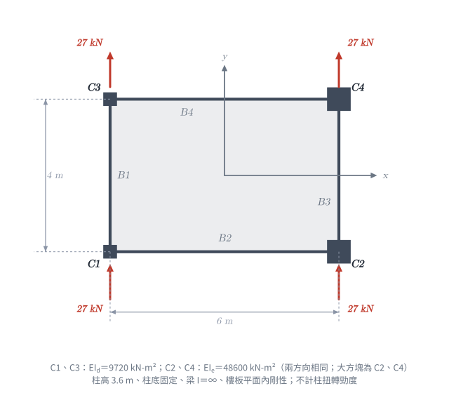

### 考題編號：SA-2021-4

**主分類：** `SA-U3-2` 建築結構系統分析
**副分類：** 無
**分析法：** 剛心法 (Center of Rigidity Method)
**標籤：** `剛性樓板` `平移與扭轉` `剛心位置` `扭轉勁度` `柱剪力分配`

---

## 1. 題目（考卷原文見題目正本）

> 考卷原文、公式／附表、附圖與判讀清單（已確認）見 [`SA-2021-4-problem.md`](SA-2021-4-problem.md)。本節只列解題時最容易讀錯的地方與本解使用的記號；題意以題目正本為準。

*重繪自考卷附圖，依判讀清單重繪。攔：把 EI 讀成一半（「kN-m²」的 2 誤當係數）、大小柱位置對調（2026-11-07 勘誤）。*

### 常見誤讀
| 項目 | 正確判讀 | 常見誤讀 |
|---|---|---|
| 柱 EI | $EI_d = 9720$、$EI_e = 48600$ kN-m²（「m²」的 2 是單位指數） | 讀成 $2EI_d = 9720$，代入 $EI_d = 4860$、$EI_e = 24300$（位移全部大一倍） |
| 大斷面柱 | C2、C4（右側兩根） | C1、C3 |
| 柱端條件 | 梁 I＝∞、樓板剛性 → 柱頂不轉；柱底固定 → $k = 12EI/h^3$ | 用 $3EI/h^3$ |

**本解記號：** 原點在平面幾何中心，$x$ 向右、$y$ 向上（平面圖）；C1(−3,−2)、C2(3,−2)、C3(−3,2)、C4(3,2) m；$k_d$、$k_e$ 為單柱側向勁度；$	heta$ 逆時針為正；位移、剪力以 $+x$、$+y$ 為正。

## 2. 考題核心精神與出題者意圖 (Core Concepts & Examiner's Intent)

本題測驗結構動力學與耐震設計中最經典的**「剛性樓板側力分配」**問題。
由於樓板具無限大平面內剛度，整塊樓板僅有三個自由度：$X$ 平移、$Y$ 平移、繞 $Z$ 軸旋轉 $\theta$。
出題者精心設計了柱的 $EI$ 值，使其經過 $k = 12EI/h^3$ 轉換後，勁度呈現完美的整數比（$2500$ 與 $12500$ kN/m，即 $1:5$）。
解題關鍵在於：
1. 算出各柱側向勁度。
2. 尋找**剛心 (Center of Rigidity, CR)** 座標。
3. 計算總側向力對剛心的**扭轉力矩 (Torsional Moment)**。
4. 計算整體的**扭轉勁度 (Torsional Stiffness, $K_\theta$)**。
5. 求出整體平移與旋轉量後，反推各柱的局部位移與剪力。

## 3. 步驟化詳細計算過程 (Step-by-Step Detailed Calculation)

### Step 1：計算柱側向勁度
因梁剛度無限大且底部固定，柱為雙向固定，其側向勁度為 $k = \frac{12EI}{h^3}$。
- $C1, C3$ 柱：$EI_d = 9720 \text{ kN-m}^2$
  $$k_d = \frac{12 \times 9720}{3.6^3} = \frac{116640}{46.656} = 2500 \text{ kN/m}$$
- $C2, C4$ 柱：$EI_e = 48600 \text{ kN-m}^2$
  $$k_e = \frac{12 \times 48600}{3.6^3} = \frac{583200}{46.656} = 12500 \text{ kN/m}$$
令 $k = 2500 \text{ kN/m}$，則 $C1, C3$ 勁度為 $k$，$C2, C4$ 勁度為 $5k$。

### Step 2：建立座標系與尋找剛心 (CR)
以幾何中心為原點 $(0,0)$，各柱座標為：
$C1(-3, -2)$，$C2(3, -2)$，$C3(-3, 2)$，$C4(3, 2)$。
$X$ 向與 $Y$ 向總勁度均為：$\sum K_x = \sum K_y = k + 5k + k + 5k = 12k$
計算剛心座標 $(x_r, y_r)$：
$$x_r = \frac{\sum K_{yi} x_i}{\sum K_y} = \frac{k(-3) + 5k(3) + k(-3) + 5k(3)}{12k} = \frac{24k}{12k} = 2 \text{ m}$$
$$y_r = \frac{\sum K_{xi} y_i}{\sum K_x} = \frac{k(-2) + 5k(-2) + k(2) + 5k(2)}{12k} = 0 \text{ m}$$
剛心 $CR$ 位於 $(2, 0)$。

### Step 3：計算總側力與扭矩
- 總 $Y$ 向力：$F_y = 27 \times 4 = 108 \text{ kN}$
- 總 $X$ 向力：$F_x = 0$
四個力對稱分佈，合力作用於幾何中心 $(0,0)$。
力臂為 $x_{force} - x_r = 0 - 2 = -2 \text{ m}$。
扭轉力矩 $M_t = F_y \cdot (-2) = 108 \times (-2) = -216 \text{ kN-m}$ （順時針）。

### Step 4：計算結構扭轉勁度 $K_\theta$
各柱相對於剛心的座標 $(x'_i = x_i - x_r, y'_i = y_i - y_r)$：
- $C1: (-5, -2)$
- $C2: (1, -2)$
- $C3: (-5, 2)$
- $C4: (1, 2)$
$$K_\theta = \sum K_{xi} (y'_i)^2 + \sum K_{yi} (x'_i)^2$$
$$= \left[ k(-2)^2 + 5k(-2)^2 + k(2)^2 + 5k(2)^2 \right] + \left[ k(-5)^2 + 5k(1)^2 + k(-5)^2 + 5k(1)^2 \right]$$
$$= [4k + 20k + 4k + 20k] + [25k + 5k + 25k + 5k]$$
$$= 48k + 60k = 108k$$
代入 $k=2500$，得 $K_\theta = 108 \times 2500 = 270000 \text{ kN-m/rad}$。

### Step 5：計算樓板總體位移
- $Y$ 向平移：$\Delta y_r = \frac{F_y}{\sum K_y} = \frac{108}{12 \times 2500} = \frac{108}{30000} = 0.0036 \text{ m} = 3.6 \text{ mm}$
- $X$ 向平移：$\Delta x_r = 0$
- 樓板扭轉角：$\theta = \frac{M_t}{K_\theta} = \frac{-216}{270000} = -0.0008 \text{ rad}$ （順時針）

### Step 6：計算 C3, C4 柱之位移與剪力
各柱端地位移公式：$u_i = \Delta x_r - \theta \cdot y'_i$， $v_i = \Delta y_r + \theta \cdot x'_i$

**對於 C3 柱：**
$x'_3 = -5$，$y'_3 = 2$
$u_3 = 0 - (-0.0008)(2) = 0.0016 \text{ m} = \mathbf{1.6 \text{ mm (向右)}}$
$v_3 = 0.0036 + (-0.0008)(-5) = 0.0036 + 0.0040 = 0.0076 \text{ m} = \mathbf{7.6 \text{ mm (向上)}}$
剪力 $V_{x3} = K_{x3} u_3 = 2500 \times 0.0016 = \mathbf{4 \text{ kN}}$
剪力 $V_{y3} = K_{y3} v_3 = 2500 \times 0.0076 = \mathbf{19 \text{ kN}}$

**對於 C4 柱：**
$x'_4 = 1$，$y'_4 = 2$
$u_4 = 0 - (-0.0008)(2) = 0.0016 \text{ m} = \mathbf{1.6 \text{ mm (向右)}}$
$v_4 = 0.0036 + (-0.0008)(1) = 0.0036 - 0.0008 = 0.0028 \text{ m} = \mathbf{2.8 \text{ mm (向上)}}$
剪力 $V_{x4} = K_{x4} u_4 = 12500 \times 0.0016 = \mathbf{20 \text{ kN}}$
剪力 $V_{y4} = K_{y4} v_4 = 12500 \times 0.0028 = \mathbf{35 \text{ kN}}$

---

## 5. 結論答案整理

**【C3 柱】**
- 柱頂 X 向位移：$1.6 \text{ mm}$ (向右)
- 柱頂 Y 向位移：$7.6 \text{ mm}$ (向上)
- 柱底 X 向剪力：$4 \text{ kN}$
- 柱底 Y 向剪力：$19 \text{ kN}$

**【C4 柱】**
- 柱頂 X 向位移：$1.6 \text{ mm}$ (向右)
- 柱頂 Y 向位移：$2.8 \text{ mm}$ (向上)
- 柱底 X 向剪力：$20 \text{ kN}$
- 柱底 Y 向剪力：$35 \text{ kN}$

**驗算：** 剪力合計 $\sum V_y = 2500(v_1+v_3) + 12500(v_2+v_4) = 108$ kN、$\sum V_x = 0$、對原點力矩平衡（2026-11-07 程式重算）。柱剪力只由勁度比（1:5）決定，不受 EI 絕對值影響；柱頂位移與 EI 成反比。

---
*修正日期：2026-11-07（§1 改為指向題目正本，補重繪附圖 figs/SA-2021-4-fig-1-problem.svg，刪除舊圖說佔位字）*
*修正日期：2026-11-07（讀題勘誤：EI_d、EI_e 依考卷為 9720、48600 kN-m²（舊解誤讀為 2EI_d＝9720，代入 4860、24300）；k_d、k_e 1250、6250 → 2500、12500 kN/m，K_θ 135000 → 270000 kN-m/rad，Δy_r 7.2 → 3.6 mm，θ −0.0016 → −0.0008 rad；C3 柱頂位移 3.2、15.2 → 1.6、7.6 mm，C4 3.2、5.6 → 1.6、2.8 mm；柱剪力 4、19、20、35 kN 不變；驗證：剛心法與 3 自由度勁度矩陣直接求解兩路徑，數值 MISMATCHES: 0）*
