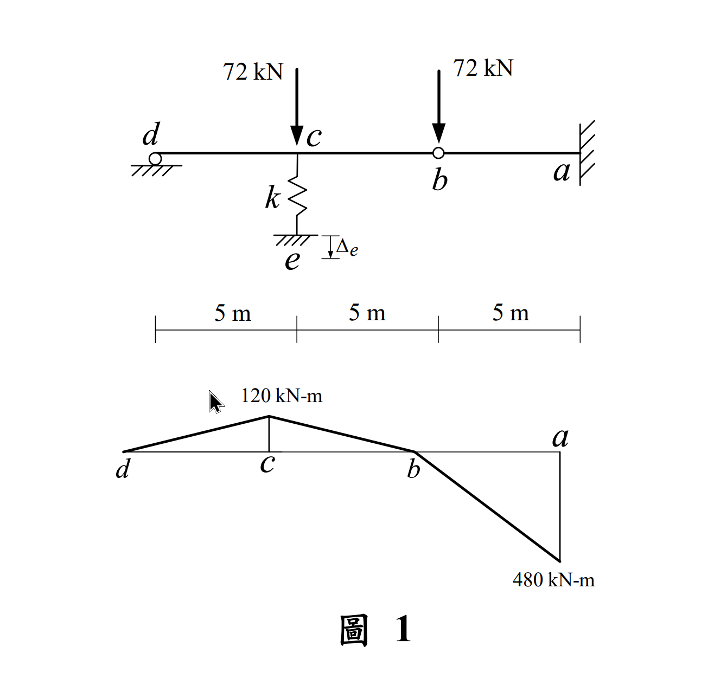
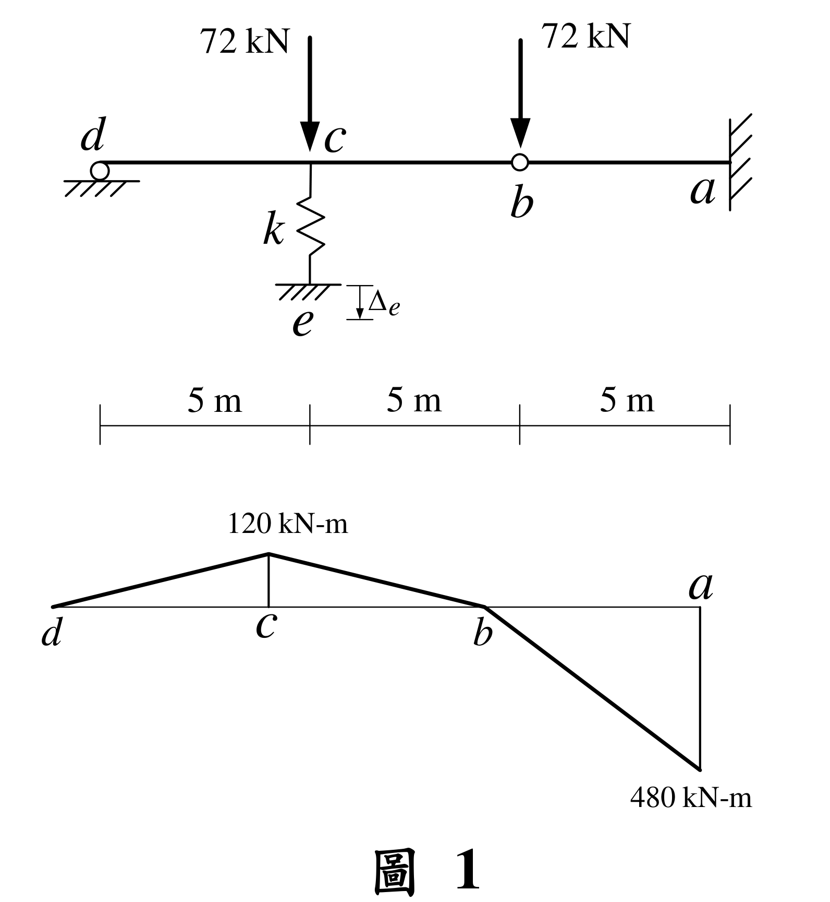

# SA-2022-1 題目正本

> 本檔只記錄考卷上寫了什麼、圖上畫了什麼，不含任何解法。解析見同資料夾 `SA-2022-1.md`。
> 判讀清單經使用者確認前，狀態為「待確認」；確認後本檔原則上不再修改（改動須回考卷原圖並記 log）。

| 項目 | 內容 |
|---|---|
| 考卷 | `raw/exams/SA-2022_結構學.pdf`，頁次 3－1，第一題（圖 1） |
| 考年 | 2022（民國 111 年）專技高考結構工程技師「結構學」 |
| 配分 | 25 分 |
| 附圖 | `SA-2022-1-fig-1.png`、`SA-2022-1-fig-2.png` |
| 判讀狀態 | **已確認**（2026-11-07 使用者確認。原轉錄：2026-11-07 轉錄；PyMuPDF 110 dpi 整頁＋300–500 dpi 局部放大、PDF 向量座標核對；盲讀於開啟解析前完成） |

## 1. 考卷原文（逐字）

一、如圖 1 所示梁結構，d 點為滾支承，b 點為鉸接，各桿件都有相同之彈性模數 E 值與慣性矩 I 值，且 EI = 250000 kN-m²，彈簧係數 k = 6000 kN/m，e 點有一向下的沉陷位移 Δe，當 b 點及 c 點各承受垂直集中載重 72 kN 時，梁結構的彎矩圖如圖 1 所示。求彈簧內力、c 點及 e 點的垂直位移。（25 分）

## 2. 考卷給的公式、附表與參數

- 考卷沒有給任何參考公式或附表。
- EI＝250000 kN-m²；k＝6000 kN/m。
- e 點有向下沉陷 Δe（**數值沒有給**，須由彎矩圖反推）。
- 題目附彎矩圖：c 點 120 kN-m（畫在基線上方）、a 點 480 kN-m（畫在基線下方）；**彎矩圖沒有標正負號，也沒有說明畫在受拉側或受壓側**。
- 卷首注意事項：㈠可以使用電子計算器。㈡不必抄題，作答時請將試題題號及答案依照順序寫在試卷上，於本試題上作答者，不予計分。㈢本科目除專門名詞或數理公式外，應使用本國文字作答。
- 考試時間：2 小時。

## 3. 附圖

*證據圖 SA-2022-1-fig-1.png*

*證據圖 SA-2022-1-fig-2.png（2026-11-07 自考卷重新擷取 500 dpi，無游標）*

圖面文字照錄：72 kN、72 kN、d、c、b、a、k、e、Δe、5 m、5 m、5 m、120 kN-m、d、c、b、a、480 kN-m、圖 1

## 4. 判讀清單

| # | 項目 | 判讀 | 圖上／題文依據 | 把握 |
|---|---|---|---|---|
| 1 | d | 滾支承（垂直反力） | 題文；圓圈＋剖線 | 確定 |
| 2 | c | 彈簧 k 支承於 c 點，彈簧下端 e 接地；e 有向下沉陷 Δe | 鋸齒線在 c 正下方 | 確定 |
| 3 | b | 內鉸（M_b＝0） | 題文；空心圓 | 確定 |
| 4 | a | 固定端 | 牆面剖線 | 確定 |
| 5 | 幾何 | d–c、c–b、b–a 各 5 m | 尺寸線分界對齊 d、c、b、a | 確定 |
| 6 | 載重 | c、b 各 72 kN 向下（b 的載重作用在內鉸上） | 箭頭尖端 x=281.9（c）、340.1（b） | 確定 |
| 7 | 彎矩圖符號 | c 點 120 畫在上方、a 點 480 畫在下方；以靜力檢核，**只有「上方＝正彎矩（下緣受拉）、下方＝負彎矩」能同時滿足 M_c＝120、M_a＝480**（反過來讀 M_a 會是 240） | 靜力：d–b 段 M_c＝5R_d | 確定（解讀）；使用者確認 |
| 8 | 考卷沒有給 | Δe 數值；彎矩圖符號規約 | 題文 | 確定 |
| 9 | 所求 | 彈簧內力；c 點、e 點垂直位移 | 題文 | 確定 |
| 10 | 證據圖 | 舊 fig-1 的游標在 120 kN-m 標註旁；新增 fig-2（500 dpi） | — | 確定 |

---
*轉錄：2026-11-07（SA-U2-1 題目正本推廣・批 1）*
*確認：2026-11-07 使用者確認*
