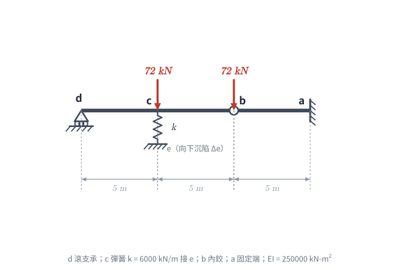
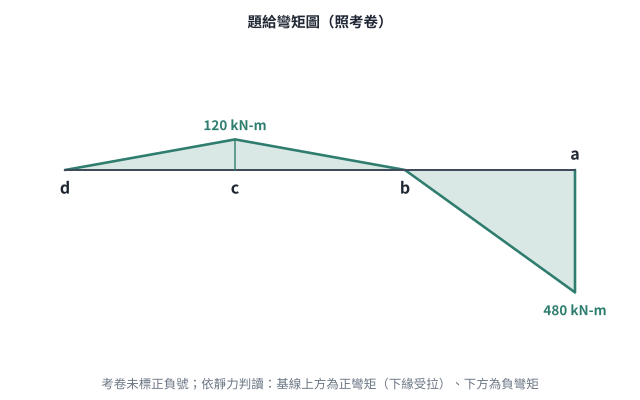
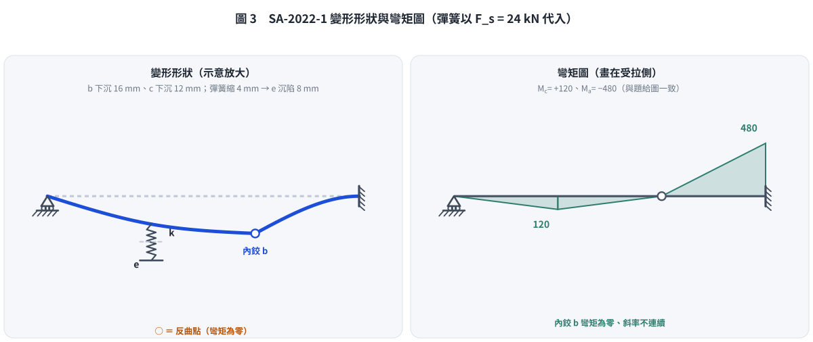

# 考題編號：SA-2022-1

**主分類：** `SA-U2-1` 靜不定結構與位移
**副分類：** 無
**分析法：** 靜力平衡與共軛梁法
**標籤：** `彎矩圖反求` `彈簧` `共軛梁法` `支承沉陷` `鉸接點`

---

## 1. 題目（考卷原文見題目正本）

> 考卷原文、公式／附表、附圖與判讀清單（已確認）見 [`SA-2022-1-problem.md`](SA-2022-1-problem.md)。本節只列解題時最容易讀錯的地方與本解使用的記號；題意以題目正本為準。

*重繪自考卷附圖，依判讀清單 #1–#10 重繪。攔：b 讀成支承、彈簧位置讀錯。*

*題給彎矩圖重繪（照考卷），依判讀清單 #7 標明正負：考卷未標，依靜力判讀上方為正彎矩。*

### 常見誤讀
| 項目 | 正確判讀 | 常見誤讀 |
|---|---|---|
| 題給彎矩圖 | 上方為正彎矩、下方為負彎矩：$M_c = +120$、$M_a = -480$ kN-m（反讀時 $M_a$ 只會是 240，與圖不符） | 正負讀反 |
| $\Delta_e$ | 考卷沒有給數值，由彎矩圖與彈簧力反推 | 當成已知 |
| b 點 | 內鉸，72 kN 作用在鉸上 | 支承 |

**本解記號：** 記號與正負號約定沿用 §4。

---

## 2. 考題核心精神與出題者意圖 (Core Concepts & Examiner's Intent)

**核心精神：**
1. **已知彎矩圖反推受力狀態**：本題結構為一階靜不定，但題目直接給定了完成彎矩圖（$M_c = 120 \text{ kN-m}$，$M_a = -480 \text{ kN-m}$）。這形同提供了解除靜不定所需的額外條件，使結構可單純以「靜力平衡」拆解游離體，反推出所有未知反力與剪力。
2. **彈簧內力與位移的相容關係**：透過靜力學解出彈簧受力後，結合梁的變形（以共軛梁法求出）及支承位移，建立 $c$ 點位移與 $e$ 點沉陷的幾何相容方程式，進而求出沉陷量。

## 3. 解題戰略地圖與陷阱分析 (Strategic Roadmap & Trap Analysis)

**戰略步驟：**
1. **切割游離體，反推鉸接剪力**：取右側懸臂梁段 $b-a$，利用已知固定端彎矩 $M_a = -480 \text{ kN-m}$ 求出 $b$ 端傳遞的總向下剪力 $R_b$。扣除 $b$ 點本身外加的 72 kN 載重，即可求出左側梁傳來的剪力 $V_b$。
2. **左梁靜力平衡，求彈簧力**：取左側簡支梁段 $d-c-b$，利用 $\sum M_d = 0$ 求出未知的彈簧向上的支撐力 $F_s$。
3. **計算 $c$ 點垂直位移**：$c$ 點的位移由兩部分組成：(1) $b$ 點下陷造成的剛體位移，(2) $d-c-b$ 梁本身的彈性彎曲變形。利用共軛梁法可求出彈性變形量，兩者疊加即為 $\Delta_c$。
4. **利用彈簧變形求 $e$ 點沉陷**：彈簧的縮短量 $\delta_s = \Delta_c - \Delta_e$。利用虎克定律 $\delta_s = F_s / k$，即可推算出 $\Delta_e$。

**陷阱分析：**
- **陷阱一：外力配置在鉸接點上**。$b$ 點承受了 72 kN 的向下外力。在切割游離體時，必須清楚這 72 kN 是跟著左梁還是右梁，或者當成獨立節點來平衡。若搞錯剪力方向或漏算 72 kN，將導致全盤皆錯。
- **陷阱二：忽略鉸接點的位移**。計算 $c$ 點位移時，千萬不能只算簡支梁的彈性變形。右側懸臂梁自由端 $b$ 會產生極大的向下位移，帶動左半部產生剛體旋轉，這是位移的主要來源。

## 3.5 變數層次分析 (Variable Hierarchy Analysis)

### 最終目標
`求彈簧內力` $F_s$、`c 點位移` $\Delta_c$、`e 點沉陷` $\Delta_e$

### 本題關鍵公式（依計算順序）

> $\boxed{\cdot}$ = 需由前步驟推導，非題目直接給定的變數

$$\text{Step 1: } R_b \cdot 5 = |M_a| \Rightarrow V_{b,left} = \boxed{R_b} - 72$$

$$\text{Step 2: } \sum M_d = 0 \Rightarrow 5 \cdot F_s + 10 \cdot \boxed{V_{b,left}} - 5 \cdot 72 = 0$$

$$\text{Step 3: } \Delta_c = \Delta_{c,rigid} + \Delta_{c,elastic} = \frac{\Delta_b}{2} + \frac{M_c^*}{EI}$$

$$\text{Step 4: } F_s = k (\boxed{\Delta_c} - \Delta_e)$$

### L1：題目直接給定

| 符號 | 數值 | 說明 |
|------|------|------|
| $EI$ | $250000 \text{ kN-m}^2$ | 梁抗彎剛度 |
| $k$ | $6000 \text{ kN/m}$ | 彈簧常數 |
| $M_a$ | $-480 \text{ kN-m}$ | 固定端彎矩 (由彎矩圖得知) |
| $M_c$ | $120 \text{ kN-m}$ | $c$ 點彎矩 (由彎矩圖得知) |
| $P_b, P_c$| $72 \text{ kN}$ | 節點外加垂直集中力 |

## 4. 步驟化詳細計算過程 (Step-by-Step Detailed Calculation)

**Step 1：依據 $b-a$ 梁段反推 $b$ 點受力**
- 取 $b-a$ 懸臂梁段為游離體（長度 5m）。$b$ 端為鉸接（$M_b = 0$），$a$ 為固定端。
- 設 $b$ 點對 $b-a$ 梁段的總向下作用力為 $R_b$。
- 由 $\sum M_a = 0$：
  $$R_b \times 5 = |M_a| = 480 \implies R_b = 96 \text{ kN (向下)}$$
- 節點 $b$ 總共受到向下 96 kN 的力。這包含了外加的 $P_b = 72 \text{ kN}$ 以及左梁 $d-c-b$ 傳來的剪力 $V_{b,L}$。
  $$V_{b,L} + 72 = 96 \implies V_{b,L} = 24 \text{ kN (向下)}$$
- 根據作用力與反作用力，右梁對左梁 $d-c-b$ 在 $b$ 點的支撐力為 **向上 24 kN**。

**Step 2：解左側 $d-c-b$ 梁段，求彈簧內力 $F_s$**
- 取 $d-c-b$ 梁段為游離體（長度 10m）。
  - $d$ 點有向上支承反力 $R_d$。
  - $c$ 點有向下外力 72 kN，以及彈簧向上的支撐力 $F_s$。
  - $b$ 點有向上的支撐力 24 kN。
- 對 $d$ 點取力矩 $\sum M_d = 0$：
  $$(F_s - 72) \times 5 + 24 \times 10 = 0$$
  $$5F_s - 360 + 240 = 0 \implies 5F_s = 120 \implies F_s = 24 \text{ kN}$$
- 故 **彈簧內力為 24 kN (受壓)**。

*(驗算：$\sum F_y = 0 \implies R_d + 24 + 24 - 72 = 0 \implies R_d = 24\text{ kN}$。計算 $c$ 點彎矩 $M_c = R_d \times 5 = 24 \times 5 = 120\text{ kN-m}$，與圖示完全相符。)*

**Step 3：計算 $c$ 點的垂直位移 $\Delta_c$**
$c$ 點的位移包含剛體位移與彈性位移：$\Delta_c = \Delta_{c,rigid} + \Delta_{c,elastic}$。
1. **剛體位移** $\Delta_{c,rigid}$：
   - $b$ 點為懸臂梁 $b-a$ 的端點，其向下變形量為：
     $$\Delta_b = \frac{R_b L_{ba}^3}{3EI} = \frac{96 \times 5^3}{3 \times 250000} = \frac{12000}{750000} = 0.016 \text{ m} = 16 \text{ mm}$$
   - $d-c-b$ 梁兩端分別沉陷 $\Delta_d = 0$ 與 $\Delta_b = 16\text{ mm}$。$c$ 點位於中點，故其剛體位移為：
     $$\Delta_{c,rigid} = \frac{0 + 16}{2} = 8 \text{ mm (向下)}$$
2. **彈性位移** $\Delta_{c,elastic}$：
   - 視 $d-c-b$ 為簡支梁，受正彎矩作用，彎矩圖為一三角形，峰值在 $c$ 點為 120 kN-m。
   - 使用共軛梁法，共軛簡支梁受向下三角形載重 $M/EI$。
   - 共軛梁總載重 $W = \frac{1}{2} \times 10 \times \frac{120}{EI} = \frac{600}{EI}$。
   - 由對稱性，共軛梁兩端反力 $V_d^* = V_b^* = \frac{300}{EI}$。
   - $c$ 點的共軛彎矩即為彈性位移：
     $$M_c^* = V_d^* \times 5 - (\frac{1}{2} \times 5 \times \frac{120}{EI}) \times \frac{5}{3} = \frac{1500}{EI} - \frac{500}{EI} = \frac{1000}{EI}$$
   - 代入 $EI = 250000$：
     $$\Delta_{c,elastic} = \frac{1000}{250000} = 0.004 \text{ m} = 4 \text{ mm (向下)}$$
3. **總位移**：
   $$\Delta_c = 8 \text{ mm} + 4 \text{ mm} = \mathbf{12 \text{ mm (向下)}}$$

**Step 4：計算 $e$ 點的垂直位移 $\Delta_e$**
- 彈簧受壓 24 kN，其壓縮量 $\delta_s$ 為：
  $$\delta_s = \frac{F_s}{k} = \frac{24}{6000} = 0.004 \text{ m} = 4 \text{ mm}$$
- 由於彈簧被壓縮，代表上端 $c$ 點往下掉的量大於下端 $e$ 點下沉的量：
  $$\Delta_c - \Delta_e = \delta_s \implies 12 \text{ mm} - \Delta_e = 4 \text{ mm}$$
  $$\Delta_e = \mathbf{8 \text{ mm (向下)}}$$

*圖 3　變形形狀與彎矩圖（彈簧以 §4 的 $F_s = 24$ kN 代入；腳本核對 $\Delta_b = 16$ mm、$\Delta_c = 12$ mm 與題給彎矩圖後才畫）。c 點下沉 12 mm，彈簧再縮 4 mm，所以 e 點只沉 8 mm。攔：把 c 點位移當成 e 點沉陷、內鉸處畫成斜率連續。*

## 5. 關鍵爭議點與進階探討 (Critical Issues & Advanced Discussion)
本題設計非常精妙，彎矩圖的給定將一階靜不定結構轉化為完全靜定。在位移計算上，容易忽略 $b$ 點作為鉸接點也會產生極大的剛體位移。若僅計算簡支梁的彈性變形（4 mm），將導致後續 $\Delta_e$ 解出錯誤的數值。

*修正日期：2026-11-07（§1 改為指向題目正本並放重繪附圖（figs/SA-2022-1-fig-1-problem.svg、figs/SA-2022-1-fig-2-problem.svg）、加常見誤讀；圖由 gen_SA-2022-1.py 產生，可重跑）*
*圖解補繪：2026-11-07（圖 3 變形與彎矩圖，向量圖，腳本 `gen_SA-2022-1.py`，可重跑）*
