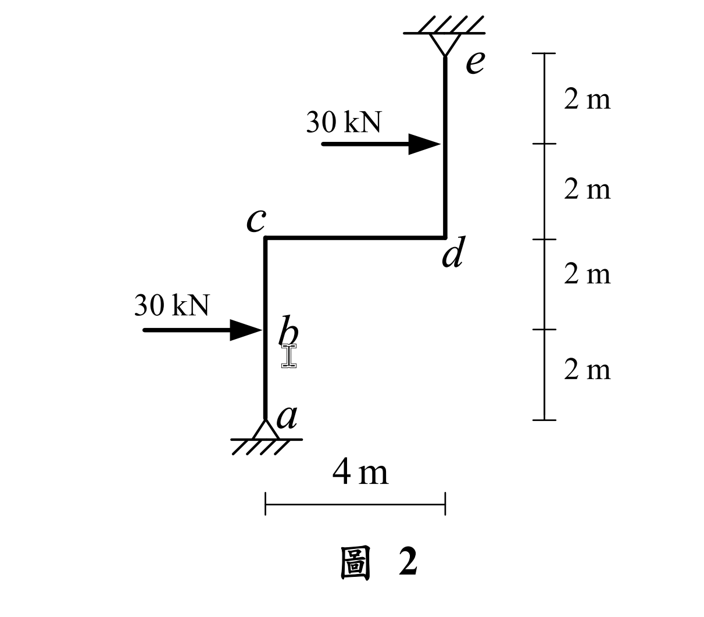
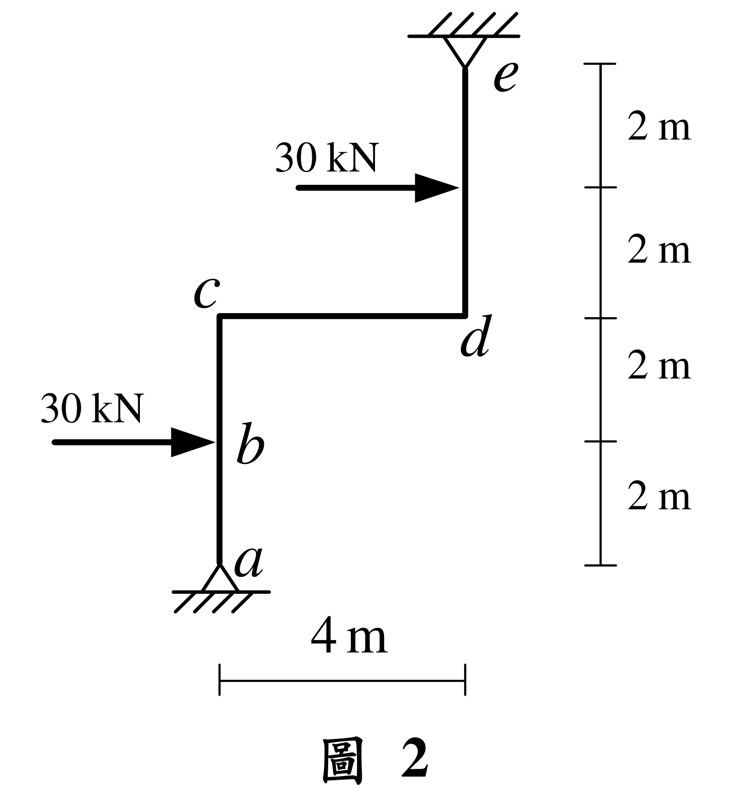

# SA-2022-2 題目正本

> 本檔只記錄考卷上寫了什麼、圖上畫了什麼，不含任何解法。解析見同資料夾 `SA-2022-2.md`。
> 判讀清單經使用者確認前，狀態為「待確認」；確認後本檔原則上不再修改（改動須回考卷原圖並記 log）。

| 項目 | 內容 |
|---|---|
| 考卷 | `raw/exams/SA-2022_結構學.pdf`，第 2 頁上半，第二題（圖 2） |
| 考年 | 2022（民國 111 年）專技高考結構工程技師「結構學」 |
| 配分 | 25 分 |
| 附圖 | `SA-2022-2-fig-1.png`、`SA-2022-2-fig-2.png` |
| 判讀狀態 | **待確認**（2026-11-05 轉錄；PyMuPDF 110 dpi 整頁＋400–500 dpi 局部放大；盲讀於開啟解析前完成） |

## 1. 考卷原文（逐字）

二、如圖 2 所示剛架結構，不考慮桿件的軸向變形，a 點及 e 點為鉸支承，桿件有相同彈性模數 E 與慣性矩 I，且 EI = 40000 kN-m²。求 cd 梁桿件的彎矩圖、b 點及 c 點的水平位移。（25 分）

## 2. 考卷給的公式、附表與參數

- 考卷沒有給任何參考公式或附表。
- EI = 40000 kN-m²（題文）。
- 卷首注意事項：㈠可以使用電子計算器。㈡不必抄題，作答時請將試題題號及答案依照順序寫在試卷上，於本試題上作答者，不予計分。㈢本科目除專門名詞或數理公式外，應使用本國文字作答。
- 考試時間：2 小時。

## 3. 附圖

*證據圖 SA-2022-2-fig-1.png*

*證據圖 SA-2022-2-fig-2.png（2026-11-05 自考卷重新擷取 500 dpi，無游標）*

圖面文字照錄：e、30 kN、c、d、30 kN、b、a、4 m、2 m、2 m、2 m、2 m、圖 2

## 4. 判讀清單

| # | 項目 | 判讀 | 圖上／題文依據 | 把握 |
|---|---|---|---|---|
| 1 | a | 鉸支承，在左柱底 | 正三角形接地剖線；題文 | 確定 |
| 2 | e | 鉸支承，在右柱頂（倒掛於頂部） | 倒三角形接上方剖線；題文 | 確定 |
| 3 | c、d | 剛接節點 | 無鉸圈 | 確定 |
| 4 | b | 左柱上的載重作用點（非節點、非鉸） | 僅標字母 | 確定 |
| 5 | 幾何 | a–b 2 m、b–c 2 m（左柱 4 m）；cd 水平 4 m；d 至右柱載重點 2 m、再至 e 2 m（右柱 4 m）；c、d 同高 | 右側尺寸四段刻度分別對齊 a、b、c/d、右柱載重點、e；下方 4 m | 確定 |
| 6 | 剛度 | 各桿 EI = 40000 kN-m² | 題文 | 確定 |
| 7 | 載重 | b 點 30 kN 向右；右柱中點（d 上方 2 m）30 kN 向右 | 箭頭方向與刻度對齊 | 確定 |
| 8 | 軸向變形 | 不考慮 | 題文 | 確定 |
| 9 | 所求 | cd 梁彎矩圖、b 點及 c 點水平位移 | 題文 | 確定 |
| 10 | 考卷沒有給 | 指定方法（題文未限定） | 題文 | 確定 |
| 11 | 證據圖 | 舊 fig-1 有文字游標壓在 b 旁；新增 fig-2（500 dpi） | — | 確定 |

---
*轉錄：2026-11-05（SA-U2-3 題目正本推廣・批 2）*
