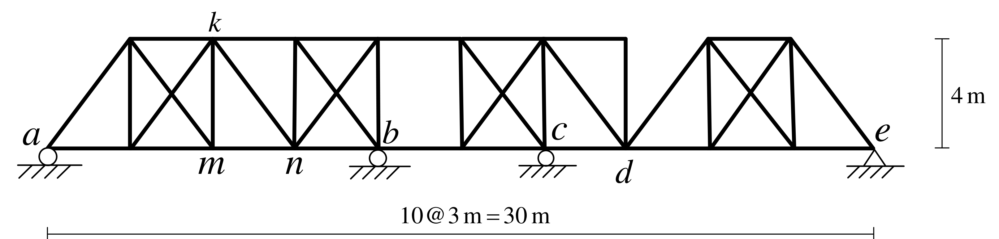

# SA-2022-3 題目正本

> 本檔只記錄考卷上寫了什麼、圖上畫了什麼，不含任何解法。解析見同資料夾 `SA-2022-3.md`。
> 判讀清單經使用者確認前，狀態為「待確認」；確認後本檔原則上不再修改（改動須回考卷原圖並記 log）。

| 項目 | 內容 |
|---|---|
| 考卷 | `raw/exams/SA-2022_結構學.pdf`，第 2 頁（頁次 3－2），第三題（圖 3） |
| 考年 | 2022（民國一百一十一年）專技高考結構工程技師「結構學」 |
| 配分 | 25 分 |
| 附圖 | `SA-2022-3-fig-2.png`（2026-11-07 重新擷取）；既有 `SA-2022-3-fig-1.png` |
| 判讀狀態 | **已確認**（2026-11-07 使用者確認。原轉錄：2026-11-07 轉錄；PyMuPDF 110 dpi 整頁＋450–1200 dpi 局部放大；考卷可抽文字，逐字原文以 PDF 文字層核對；盲讀於開啟解析前完成） |

## 1. 考卷原文（逐字）

三、如圖 3 所示桁架結構，a、b、c 點為滾支承，e 點為鉸支承，各桿件有相同彈性模數 E 與斷面積 A。當單位載重在桁架底弦移動，分別求 a 點反力、b 點反力、c 點反力、mn 桿件軸力及 nk 桿件軸力的影響線。（25 分）

## 2. 考卷給的公式、附表與參數

- 考卷沒有給任何參考公式或附表。
- 各桿 EA 相同，沒有給數值。
- 卷首注意事項：㈠可以使用電子計算器。㈡不必抄題，作答時請將試題題號及答案依照順序寫在試卷上，於本試題上作答者，不予計分。㈢本科目除專門名詞或數理公式外，應使用本國文字作答。
- 考試時間：2 小時。

## 3. 附圖

*證據圖 SA-2022-3-fig-2.png（2026-11-07 自考卷 500 dpi 重新擷取）；既有 SA-2022-3-fig-1.png 帶有滑鼠游標（箭頭游標在左上角空白處，未壓到桿件），保留不改。*

圖面文字照錄：k、a、m、n、b、c、d、e、4 m、10@3 m = 30 m、圖 3

## 4. 判讀清單

| # | 項目 | 判讀 | 圖上／題文依據 | 把握 |
|---|---|---|---|---|
| 1 | 下弦節點（以 a 為原點，m） | a(0)、x3、m(6)、n(9)、b(12)、x15、c(18)、d(21)、x24、x27、e(30)；下弦 a–e 連續 | 下方「10@3 m = 30 m」；各豎桿與字母位置量得（500 dpi，換算 55 px/m） | 確定 |
| 2 | 上弦節點（高 4 m） | T3、k(6)、T9、T12、T15、T18、T21 一段連續；T24、T27 另一段；x = 21–24 m 之間沒有上弦 | 500 dpi：上弦線止於 d 上方豎桿 | 確定 |
| 3 | 豎桿 | x = 3、6、9、12、15、18、21、24、27 m 各一根 | 500 dpi | 確定 |
| 4 | 斜桿 | a–T3；格 3–6 X 形（T3–m、B3–k）；k–n（由 k 往右下到 n）；格 9–12 X 形；格 12–15 無斜桿；格 15–18 X 形；T18–d；d–T24；格 24–27 X 形；T27–e | 500 dpi | 確定 |
| 5 | 格 12–15 | 只有上下弦與兩側豎桿，沒有斜桿 | 500 dpi | 確定 |
| 6 | 支承 | a、b、c 滾支承（圓圈）；e 鉸支承（三角形） | 題文＋圖面 | 確定 |
| 7 | 計數 | j = 20、m = 39、r = 5：m + r − 2j = 4 | 計數 | 確定 |
| 8 | mn 桿 | 下弦 x = 6–9 m 一格 | m、n 字母位置 | 確定 |
| 9 | nk 桿 | 斜桿 k(6,4)–n(9,0) | k、n 字母位置與該格只有一根斜桿 | 確定 |
| 10 | EA | 各桿相同 | 題文 | 確定 |
| 11 | 移動載重 | 單位載重在底弦移動（題文未寫方向，慣例向下） | 題文 | 確定（解讀）；使用者確認 |
| 12 | 所求 | a、b、c 點反力，mn、nk 桿軸力的影響線 | 題文 | 確定 |

---
*轉錄：2026-11-07（SA-U1-3 題目正本推廣・批 1）*
*確認：2026-11-07 使用者確認*
