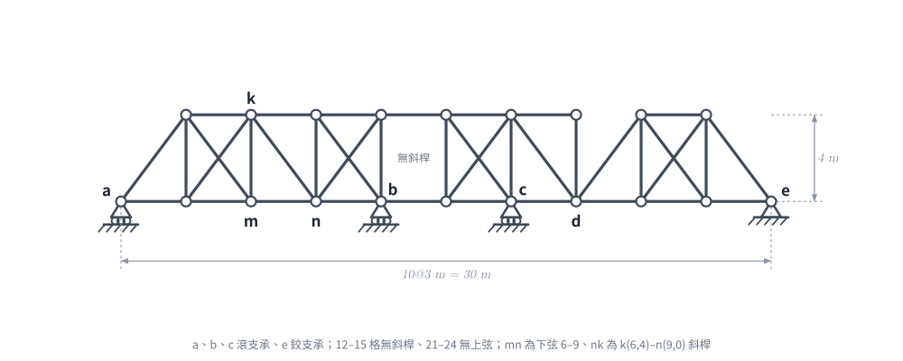
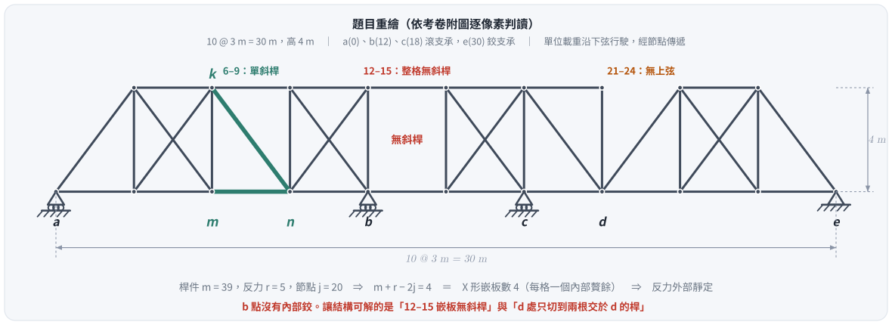
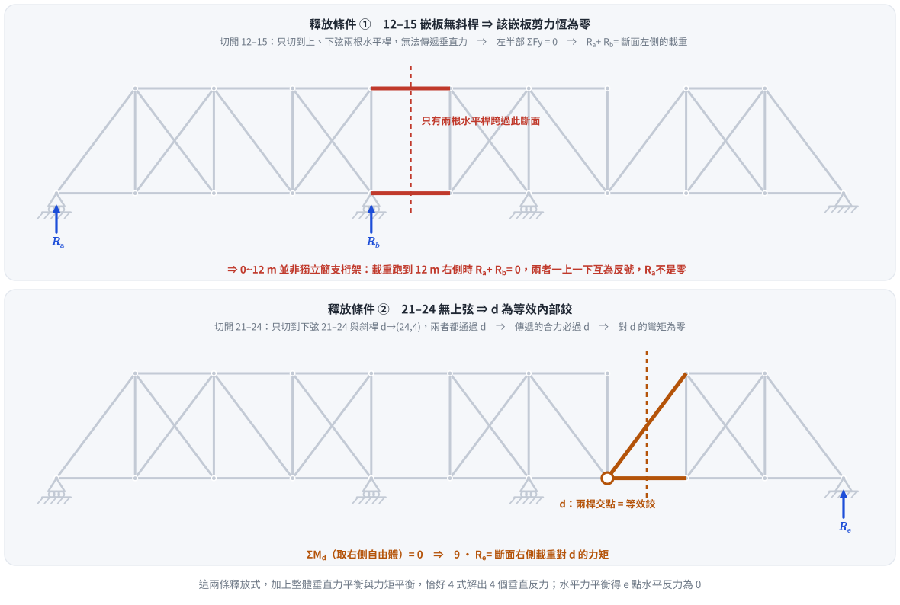
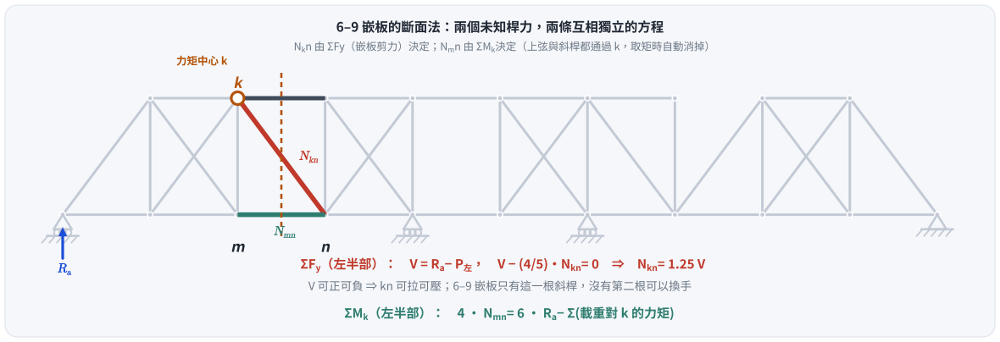
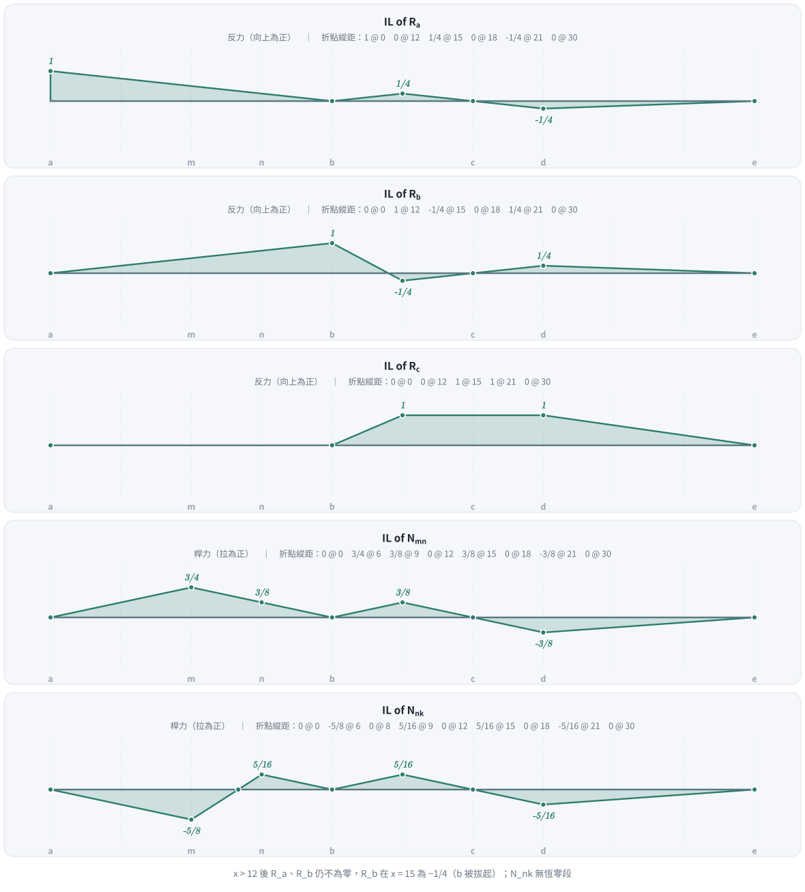

# 考題編號：SA-2022-3

**主分類：** `SA-U1-3` 靜定及靜不定結構影響線
**副分類：** 無
**分析法：** 影響線（Influence Lines）、斷面法、桁架釋放條件（剪力釋放、等效內鉸）
**標籤：** `影響線` `桁架` `等效內鉸` `間接載重` `無斜桿嵌板`

---

## 1. 題目（考卷原文見題目正本）

> 考卷原文、公式／附表、附圖與判讀清單（已確認）見 [`SA-2022-3-problem.md`](SA-2022-3-problem.md)。本節只列解題時最容易讀錯的地方與本解使用的記號；題意以題目正本為準。

*重繪自考卷附圖，依判讀清單 #1–#13 重繪。攔：6–9 格讀成 X 形、12–15 格補上斜桿、b 讀成內鉸。*

### 常見誤讀
| 項目 | 正確判讀 | 常見誤讀 |
|---|---|---|
| 6–9 格 | 只有一根斜桿 nk（k(6,4)–n(9,0)） | X 形交叉 |
| 12–15 格 | 無斜桿 | 補上斜桿 |
| 上弦 | x = 3–21 與 24–27 兩段，21–24 無上弦 | 全長連續 |
| X 形斜撐 | 考卷只寫各桿 E、A 相同，沒有「細長拉桿」條件 | 當成只受拉的細長拉桿（本解 2026-11-07 前的版本） |
| 所求 | $R_a$、$R_b$、$R_c$、$N_{mn}$、$N_{nk}$ 五條 | km、kn、mn（本解 2026-10-28 前的版本） |

**本解記號：** 本文的 $N_{kn}$ 即考卷的 nk 桿；記號與正負號約定沿用 §4。

---

## 1.5 ⚠ 附圖的三個判讀重點（本題成敗全在這裡）

考卷附圖線條密集，最容易看走眼。以下配置係對附圖**逐像素掃描**（取上弦所在列與半高列的暗像素分佈）確認，非目視推測：

| 掃描結果 | 意義 |
|---|---|
| 上弦連續段為 $x=3\to21$ 與 $x=24\to27$ | **21～24 之間沒有上弦**；$3\sim21$ 全段連續，**$b(12)$ 處沒有任何斷開** |
| 半高交會點：1.5、4.5、7.5、10.5、16.5、19.5、22.5、25.5、28.5 | **12～15 之間沒有任何斜桿** |
| 4.5、10.5、16.5、25.5 為兩線交會 | 3–6、9–12、15–18、24–27 四格為 **X 型交叉斜桿** |
| 7.5、19.5、22.5、1.5、28.5 為單線 | 0–3、**6–9**、18–21、21–24、27–30 為**單斜桿** |

由此得到三個關鍵事實：

1. **$kn$ 是 6–9 嵌板唯一的斜桿**，不是 X 形交叉斜桿的一根。6–9 嵌板的剪力全由它承擔（$N_{kn}=\frac54 V$），剪力變號時它跟著由拉轉壓 —— $IL_{N_{kn}}$ **沒有任何一段恆為零**。
2. **12–15 嵌板整格沒有斜桿**，該嵌板剪力恆為零。這才是讓結構可解的釋放條件。
3. **$b$ 點沒有內部鉸**，$0\sim12$ m 也**不是**一段獨立的簡支桁架。載重跑到 $x>12$ 時 $R_a$ 仍然有值（而且會變號）。

*圖 1　題目重繪（向量版，幾何由附圖像素掃描而來）。這張圖攔的是本題三個致命誤讀：把 6–9 當成交叉斜桿、把 12–15 當成有斜桿、在 $b$ 點捏造內部鉸 —— 任一項錯了，五條影響線全部作廢。*

---

## 2. 考題核心精神與出題者意圖 (Core Concepts & Examiner's Intent)

**核心精神：**

1. **贅餘在哪裡要數得出來。** 桿件 $m=39$、反力 $r=5$、節點 $j=20$，$m+r-2j=4$，恰好等於 X 形嵌板數：每格 X 形嵌板有一個內部贅餘（兩根斜桿如何分擔嵌板剪力，要由變形諧合決定）。但這 4 個贅餘不影響反力，也不影響 6–9 嵌板的桿力 —— 題目所求五條影響線只需平衡加兩個釋放條件。（考卷寫明各桿 $E$、$A$ 相同，並沒有「細長拉桿」條件。）
2. **兩個「結構自己給的」靜力條件。** 4 個垂直反力只有 2 條整體平衡式可用，還差 2 條：
    - 12–15 嵌板無斜桿 $\Rightarrow$ 該嵌板剪力恆為零；
    - 21–24 只切到兩根交於 $d$ 的桿 $\Rightarrow$ $d$ 為等效內部鉸。
3. **單斜桿與 X 形嵌板的分辨。** 單斜桿的嵌板剪力只能由它一根承擔（$N=\frac54 V$），剪力變號它就變號；X 形嵌板的兩根斜桿共同承擔剪力，比例由變形諧合決定。本題所求的 $kn$ 是單斜桿。
4. **間接載重傳遞。** 載重行駛於下弦，經節點傳入桁架，故影響線在節點之間為直線。

---

## 3. 解題戰略地圖與陷阱分析 (Strategic Roadmap & Trap Analysis)

**戰略步驟：**

1. **判定贅餘位置**：數 $m$、$r$、$j$，確認 $m+r-2j$ 的贅餘全在 X 形嵌板內部（不影響所求）。
2. **找出兩個釋放條件**：掃描每一格，找「無斜桿的嵌板」與「只切到兩根共點桿的斷面」。
3. **解 $R_a$、$R_b$、$R_c$ 影響線**：以兩個釋放條件加整體 $\Sigma F_y$、$\Sigma M$ 求四個垂直反力。
4. **斷面法求桿力**（$N_{kn}$、$N_{mn}$）：
    - $N_{kn}$（斜桿）$\to$ 6–9 嵌板 $\Sigma F_y$；
    - $N_{mn}$（下弦）$\to$ 對 $k(6,4)$ 取矩（上弦與斜桿都通過 $k$）；

**陷阱分析：**

| 陷阱 | 為什麼會錯 | 正解 |
|---|---|---|
| **在 $b$ 點捏造內部鉸** | 想湊出「$0\sim12$ m 是簡支桁架」的簡單模型 | 上弦 $3\to21$ 連續，$b$ 只是滾支承。真正的釋放在 12–15 嵌板與 $d$ 點 |
| **以為 $x>12$ 後 $R_a=0$** | 承上，把左段當獨立結構 | $R_a$ 在 $x=15$ 回升到 $+1/4$、在 $x=21$ 變號到 $-1/4$（a 支承被拔起）；$R_b$ 在 $x=15$ 為 $-1/4$（b 支承被拔起） |
| **把 $kn$ 當成 X 形斜桿的一根** | 看到旁邊幾格是 X 型就類推 | 6–9 只有一根斜桿，$N_{kn}$ 在 $x=6$ 達到最大**壓力** $-5/8$ |
| **忽略 21～30 的貢獻** | 覺得離 $kn,mn$ 太遠 | 經由 $d$ 的等效鉸傳遞，兩根桿在 $21\sim30$ 都有非零（且為反號）的縱距 |

---

## 3.5 變數層次分析 (Variable Hierarchy Analysis)

### 最終目標

`繪製 R_a、R_b、R_c、N_mn、N_nk 五條影響線（載重沿下弦由 a 走到 e）`

### 本題關鍵公式（依計算順序）

> $\boxed{\cdot}$ ＝ 需由前步驟推導，非題目直接給定

$$\text{Step 0: } m + r - 2j = \boxed{4} = \text{X 形嵌板內部贅餘數} \;\Rightarrow\; \text{反力外部靜定}$$

$$\text{Step 1: } R_a + R_b = P_{\text{左}}\big|_{\text{12–15 斷面}} \quad\text{（無斜桿嵌板）}$$

$$\text{Step 2: } 9\,R_e = \textstyle\sum P_{\text{右}}\,(x-21) \quad\text{（}d\text{ 等效內鉸）}$$

$$\text{Step 3: } \boxed{R_a},\ \boxed{R_b},\ \boxed{R_c}\;\text{由 Step 1、2 加整體 } \Sigma F_y,\ \Sigma M_a \text{ 解出}$$

$$\text{Step 4: } V(x) = \boxed{R_a} - P_{\text{左}}, \qquad N_{kn} = \tfrac{5}{4}\boxed{V}$$

$$\text{Step 5: } 4\,N_{mn} = 6\boxed{R_a} - \textstyle\sum(\text{載重對 }k\text{ 的力矩})$$

### L1：題目直接給定

| 符號 | 數值 | 說明 |
|---|---|---|
| $\lambda$ | $3\text{ m}$ | 嵌板寬（10 @ 3 m = 30 m） |
| $h$ | $4\text{ m}$ | 桁架高 |
| 支承 | $a(0)$、$b(12)$、$c(18)$ 滾，$e(30)$ 鉸 | 4 個垂直反力 + 1 個水平反力 |

### L2：需知識點推導

| 符號 | 公式／來源 | 卡關? |
|---|---|:--:|
| $m,r,j$ | 由附圖數出：$39,\;5,\;20$ | |
| $\sin\theta$ | $4/5$（3-4-5 直角三角形）$\Rightarrow$ 斜桿垂直分量係數 | |
| 12–15 剪力 | 該嵌板只有兩根水平桿跨越 $\Rightarrow V\equiv0$ | |
| $d$ 的鉸性 | 21–24 斷面只切到兩根**交於 $d$** 的桿 $\Rightarrow M_d=0$ | |
| $x_{\text{zero}}$（6–9） | $V=(x-8)/4=0 \Rightarrow x=8$ | |

### L3：深層知識（不懂就卡住）

| 知識點 | 說明 | 卡關? |
|---|---|:--:|
| X 形嵌板的內部贅餘 | 兩根斜桿分擔嵌板剪力的比例需由變形諧合決定；所求的反力與 6–9 嵌板桿力只需平衡即可求得 | |
| 無斜桿嵌板 = 剪力釋放 | 上下弦皆水平 $\Rightarrow$ 跨過該斷面的力只有水平分量 $\Rightarrow$ 垂直力無法傳遞 | |
| 兩桿共點 = 等效內鉸 | 只切到兩根桿且交於一點時，傳遞的合力必過該點 $\Rightarrow$ 對該點彎矩為零 | |
| 間接載重的線性 | 載重在節點間依槓桿分配 $\Rightarrow$ IL 在節點間為直線 | |

---

## 4. 步驟化詳細計算過程 (Step-by-Step Detailed Calculation)

### Step 0：靜定判定

| 項目 | 數量 |
|---|---|
| 下弦桿 | 10 |
| 上弦桿（$3\!\sim\!21$ 六段 ＋ $24\!\sim\!27$ 一段） | 7 |
| 垂直桿（$x=3,6,\dots,21,24,27$） | 9 |
| 斜桿（$1+2+1+2+0+2+1+1+2+1$） | 13 |
| **$m$** | **39** |
| **$r$** | **5**（$a,b,c$ 各 1，$e$ 為 2） |
| **$j$** | **20**（下弦 11 ＋ 上弦 9） |

$$m + r - 2j = 39 + 5 - 40 = 4 = \text{X 形嵌板數}$$

四個贅餘都在 X 形嵌板內部（每格一個）；外部反力 5 個，由整體平衡 3 式加兩個釋放條件（Step 1、2）恰可求出 $\Rightarrow$ **反力外部靜定**。無需假設 $b$ 有鉸。

---

### Step 1、2：兩個釋放條件

*圖 2　讓 4 個垂直反力可解的兩條額外方程。這張圖攔的是「$0\sim12$ m 是獨立簡支桁架」的誤判：釋放條件 ① 給的是 $R_a+R_b=P_{\text{左}}$，不是 $R_a$ 與右半部無關。*

**① 12–15 嵌板無斜桿：** 於 $x=13.5$ 切斷，只切到上弦 $(12,4)\!-\!(15,4)$ 與下弦 $(12,0)\!-\!(15,0)$，兩者皆水平，無法傳遞垂直力。取左半部：

$$\sum F_y = 0:\qquad R_a + R_b = P_{\text{左}}$$

其中 $P_{\text{左}}$ 為經節點傳遞後落在 $x\le12$ 的載重量。**載重在 $x\ge15$ 時 $R_a+R_b=0$** —— 兩支承一上一下，$R_a$ 不為零。

**② $d$ 為等效內鉸：** 於 $x=22.5$ 切斷，只切到下弦 $(21,0)\!-\!(24,0)$ 與斜桿 $(21,0)\!-\!(24,4)$，兩者都通過 $d(21,0)$，故傳遞的合力必過 $d$。取右半部對 $d$ 取矩：

$$\sum M_d^{\text{right}} = 0:\qquad 9\,R_e = \sum_{x_i>21} P_i\,(x_i - 21) \;=\; \max(x-21,\,0)$$

（節點傳遞不改變載重對任一點的力矩，故右式可直接寫成載重位置的函數。）

---

### Step 3：$R_a$、$R_b$、$R_c$ 影響線

以 ①、② 加整體 $\Sigma F_y = 1$ 與 $\Sigma M_a$：$12R_b + 18R_c + 30R_e = x$，逐段解得：

| 載重位置 | $R_e$ | $R_c$ | $R_a$ | $R_b = 1-R_a-R_c-R_e$ |
|---|---|---|---|---|
| $0\le x\le 12$ | $0$ | $0$ | $\dfrac{12-x}{12}$ | $\dfrac{x}{12}$ |
| $12\le x\le 15$ | $0$ | $1-\dfrac{15-x}{3}$ | $\dfrac{x-12}{12}$ | $1-\dfrac{5(x-12)}{12}$ |
| $15\le x\le 21$ | $0$ | $1$ | $\dfrac{18-x}{12}$ | $\dfrac{x-18}{12}$ |
| $21\le x\le 30$ | $\dfrac{x-21}{9}$ | $1-\dfrac{x-21}{9}$ | $\dfrac{x-30}{36}$ | $\dfrac{30-x}{36}$ |

**$R_a$ 縱距：** $1@0$、$0@12$、$+\frac14@15$、$0@18$、$-\frac14@21$、$0@30$。

**$R_b$ 縱距：** $0@0$、$1@12$、$-\frac14@15$、$0@18$、$+\frac14@21$、$0@30$。載重在 $x\ge15$ 時由釋放條件 ① 得 $R_b=-R_a$，兩者鏡像；$x=15$ 時 $R_b<0$，**$b$ 支承被拔起**。

**$R_c$ 縱距：** $0@0\sim12$、$1@15$、$1@21$（$15\sim21$ 恆為 $1$）、$0@30$。

> **驗算（載重在 $x=24$）：** $R_e = \frac{3}{9} = \frac13$，$R_c = \frac23$，$R_a = -\frac16$，$R_b = +\frac16$。
> $\Sigma F_y: -\frac16+\frac16+\frac23+\frac13 = 1$ ✓
> $\Sigma M_a: 12(\frac16)+18(\frac23)+30(\frac13) = 2+12+10 = 24$ ✓
> 釋放 ①：$R_a+R_b = 0$（載重在 12–15 斷面右側）✓
> 釋放 ②：$9(\frac13) = 3 = 24-21$ ✓

---

### Step 4、5：斷面法求 $N_{kn}$ 與 $N_{mn}$

*圖 3　6–9 嵌板只有一根斜桿。這張圖攔的是把 $kn$ 當成 X 形斜桿的一根：6–9 嵌板只有它一根斜桿，嵌板剪力為負時它必須受壓，影響線因此連續、沒有零平台。*

於 $x=7.5$ 切斷，切到上弦 $(6,4)\!-\!(9,4)$、斜桿 $kn$、下弦 $mn$。

**$N_{kn}$（$\Sigma F_y$）：** $kn$ 方向 $(3,-4)/5$，對左半部的垂直分量為 $-\frac45 N_{kn}$：

$$V(x) = R_a(x) - P_{\text{左}}, \qquad V - \tfrac45 N_{kn} = 0 \;\Rightarrow\; \boxed{N_{kn} = \tfrac54 V}$$

載重在嵌板內（$6\le x\le9$）時 $P_{\text{左}} = \frac{9-x}{3}$：

$$V = \frac{12-x}{12} - \frac{9-x}{3} = \frac{x-8}{4} \;\Rightarrow\; \textbf{變號點 } x = 8$$

**$N_{mn}$（$\Sigma M_k$）：** 上弦與斜桿都通過 $k(6,4)$，取矩自動消掉：

$$4\,N_{mn} = 6\,R_a - \sum_{x_i<7.5} P_i\,(6-x_i)$$

- $0\le x\le6$：$4N_{mn} = 6\cdot\frac{12-x}{12} - (6-x) = \frac{x}{2} \Rightarrow N_{mn} = \dfrac{x}{8}$
- $x\ge9$：$N_{mn} = 1.5\,R_a$
- $6\le x\le9$：兩端值 $\frac34$ 與 $\frac38$，直線連接

---

### 4.7 影響線與縱距總表（題目所求五條）

*圖 4　題目所求五條影響線。這張圖攔兩件事：以為 $x>12$ 之後 $R_a$、$R_b$ 全部歸零（其實 $x=15$ 時 $R_b=-\frac14$）、以為 $N_{nk}$ 有恆為零的平台。*

| $x$ (m) | 0 | 3 | **4** | 6 | **8** | 9 | 12 | 15 | 18 | 21 | 24 | 27 | 30 |
|:--|:--:|:--:|:--:|:--:|:--:|:--:|:--:|:--:|:--:|:--:|:--:|:--:|:--:|
| $R_a$ | $1$ | $\frac34$ | $\frac23$ | $\frac12$ | $\frac13$ | $\frac14$ | $0$ | $\frac14$ | $0$ | $-\frac14$ | $-\frac16$ | $-\frac1{12}$ | $0$ |
| $R_b$ | $0$ | $\frac14$ | $\frac13$ | $\frac12$ | $\frac23$ | $\frac34$ | $1$ | $-\frac14$ | $0$ | $\frac14$ | $\frac16$ | $\frac1{12}$ | $0$ |
| $R_c$ | $0$ | $0$ | $0$ | $0$ | $0$ | $0$ | $0$ | $1$ | $1$ | $1$ | $\frac23$ | $\frac13$ | $0$ |
| $N_{mn}$ | $0$ | $\frac38$ | $\frac12$ | $\frac34$ | $\frac12$ | $\frac38$ | $0$ | $\frac38$ | $0$ | $-\frac38$ | $-\frac14$ | $-\frac18$ | $0$ |
| $N_{nk}$ | $0$ | $-\frac5{16}$ | $-\frac5{12}$ | $-\frac58$ | $0$ | $\frac5{16}$ | $0$ | $\frac5{16}$ | $0$ | $-\frac5{16}$ | $-\frac5{24}$ | $-\frac5{48}$ | $0$ |

（拉為正，壓為負；$R_a$ 向上為正。）

**極值：**

| 量 | 最大正值 | 最大負值 |
|---|---|---|
| $R_a$ | $+1$（$x=0$） | $-\frac14$（$x=21$，a 被拔起） |
| $R_b$ | $+1$（$x=12$） | $-\frac14$（$x=15$，b 被拔起） |
| $R_c$ | $+1$（$15\le x\le21$） | 無（恆 $\ge0$） |
| $N_{mn}$ | $+\frac34$ 拉（$x=6$） | $-\frac38$ 壓（$x=21$） |
| $N_{nk}$ | $+\frac5{16}$ 拉（$x=9$ 或 $x=15$） | $-\frac58$ 壓（$x=6$） |

---

## 5. 關鍵爭議點與進階探討 (Critical Issues & Advanced Discussion)

**（一）贅餘在哪裡，比贅餘有幾個更重要。** 本題的桁架看起來像是多跨連續＋高次靜不定，$m+r-2j=4$，而四個贅餘恰好都在 X 形嵌板內部；外部反力則由兩個釋放條件補足方程數。所以題目所求五條影響線都只靠平衡就能求得（2026-11-07 以 39 桿等 EA 彈性桁架勁度法逐節點驗證相同）。**不需要**、也**不可以**再額外假設任何內部鉸。

**（二）三種「釋放」的辨識法。** 桁架裡讓結構軟化的機制有三種，都靠「數斷面切到幾根桿」判斷：

| 斷面切到的桿 | 等效於 |
|---|---|
| 兩根**平行**桿（如本題 12–15 的上、下弦） | 剪力釋放（垂直力無法傳遞） |
| 兩根**共點**桿（如本題 21–24） | 內部鉸（對交點彎矩為零） |
| 三根桿（一般嵌板） | 完整傳遞 $N$、$V$、$M$，無釋放 |

**（三）單斜桿 vs. X 形嵌板。**

- 單斜桿（$kn$）：$N = \frac54 V$ 恆成立，$V$ 變號它就變號。IL 連續、無平台，最大壓力可能比最大拉力還大（本題 $\frac58$ vs $\frac5{16}$，差兩倍）。設計上這根桿的挫屈檢核才是控制項。
- X 形嵌板：兩根斜桿共同承擔嵌板剪力，各自的內力要由變形諧合決定（每格一個內部贅餘）；本題所求不涉及它們。

**（四）$R_a$ 會變號的物理意義。** 載重走到 $x>18$ 之後 $R_a<0$：$a$ 支承被**拔起**。滾支承通常只能承壓，實務上此處需設計繫件（hold-down）或以自重壓住。這是影響線在工程判斷上最直接的用途之一 —— 它告訴你哪個支承會在什麼載重位置被掀開。

---

## 6. 本題知識點索引

| 知識點 | 概念 ID |
|---|---|
| 影響線 | [[INFLUENCE-LINE]] |
| 桁架斷面法 | [[TRUSS-SECTION-METHOD]] |
| 靜不定度判斷 | [[DEGREE-OF-INDETERMINACY]] |

---

*解析日期：2026-07-02　｜　2026-10-28 依考卷原文更正題目要求，補 $R_b$、$R_c$ 影響線（以獨立的桁架有限元＋細長拉桿疊代在 121 個載重位置逐點比對五條 IL，誤差 $<10^{-14}$）　｜　重算＋圖解補繪：2026-08-26（附圖幾何經逐像素掃描確認；四條影響線與獨立的「桁架有限元＋細長拉桿互補條件」在 121 個載重位置逐點比對相符；向量圖腳本 `gen_SA-2022-3.py`，可重跑）*

*修正日期：2026-11-07（§1 改為指向題目正本並放重繪附圖（figs/SA-2022-3-fig-1-problem.svg）、加常見誤讀；圖由 gen_SA-2022-3_problem.py 產生，可重跑）*
*修正日期：2026-11-07（非勘誤）刪除考卷沒有的「細長拉桿（只受拉）」假設與據此算出的補充 $N_{km}$（使用者決定）；題目所求 R_a、R_b、R_c、N_mn、N_nk 五條影響線不變，已以 39 桿等 EA 彈性桁架勁度法逐節點驗證；gen_SA-2022-3.py 圖 1–4 同步（X 形斜撐改實線、刪除 N_km 格）*
*圖解修正：2026-11-07（外觀修正（非勘誤），數值不變：圖 2、圖 4 註腳改用中文（原 ΣF_{y}、R_a、N_nk 等下標字元外露）；圖由 gen_SA-2022-3.py 重產）*
