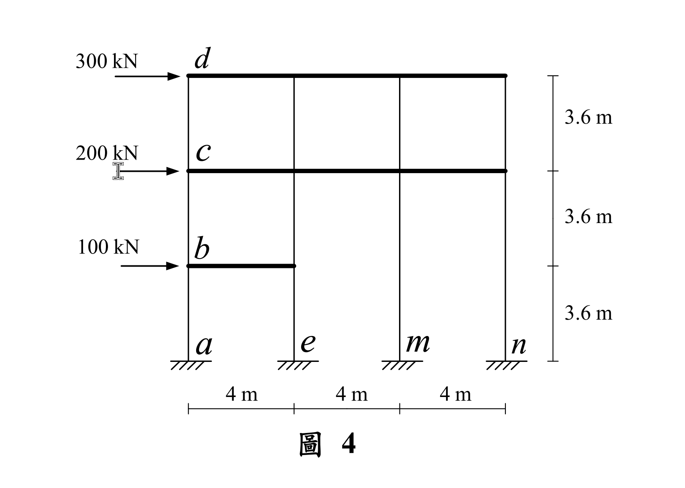
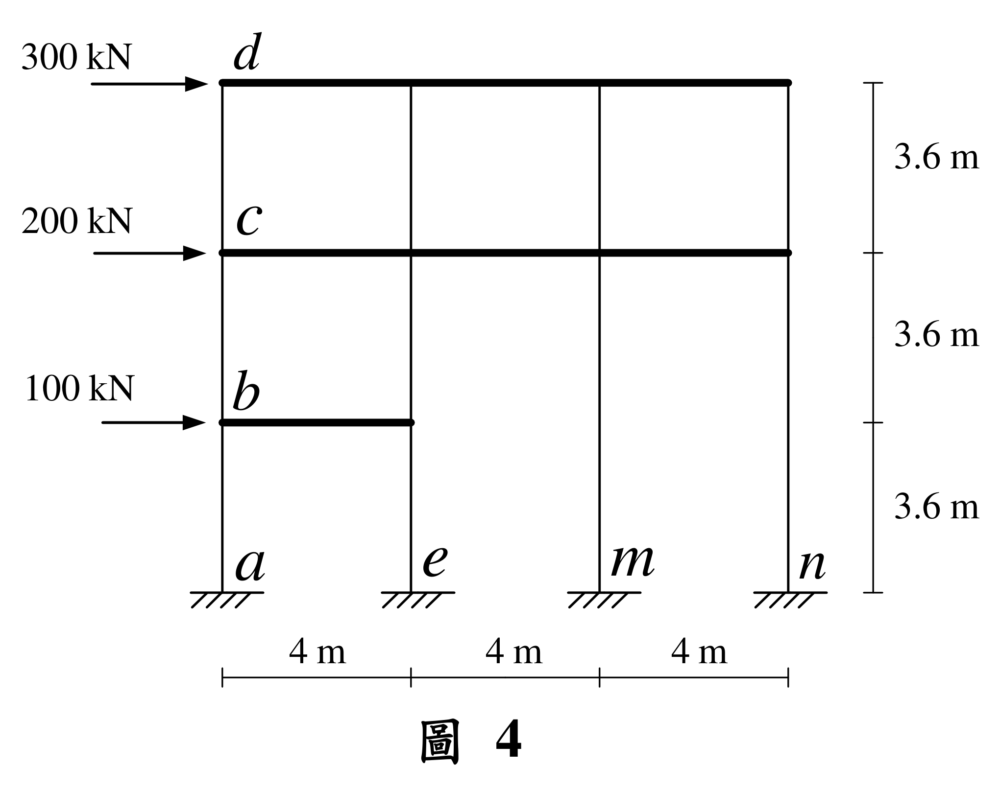

# SA-2022-4 題目正本

> 本檔只記錄考卷上寫了什麼、圖上畫了什麼，不含任何解法。解析見同資料夾 `SA-2022-4.md`。
> 判讀清單經使用者確認前，狀態為「待確認」；確認後本檔原則上不再修改（改動須回考卷原圖並記 log）。

| 項目 | 內容 |
|---|---|
| 考卷 | `raw/exams/SA-2022_結構學.pdf`，第 3 頁，第四題（圖 4） |
| 考年 | 2022（民國 111 年）專技高考結構工程技師「結構學」 |
| 配分 | 25 分 |
| 附圖 | `SA-2022-4-fig-1.png`、`SA-2022-4-fig-2.png` |
| 判讀狀態 | **已確認**（2026-11-05 使用者確認。原轉錄：2026-11-05 轉錄；PyMuPDF 110 dpi 整頁＋250–800 dpi 局部放大、PDF 向量座標；盲讀於開啟解析前完成） |

## 1. 考卷原文（逐字）

四、如圖 4 所示三層樓構架，各樓層承受水平外力，構架梁柱桿件的彈性模數都為 E，另構架之柱桿件斷面慣性矩都為 I，且 EI = 97200 kN-m²，而構架之梁桿件斷面慣性矩為無限大。不考慮構架梁柱桿件的軸向變形，求 c 點水平位移、b 點水平位移、a 點及 m 點固定端的水平反力與彎矩。（25 分）

## 2. 考卷給的公式、附表與參數

- 考卷沒有給任何參考公式或附表。
- 柱 EI = 97200 kN-m²；梁 I 無限大；不考慮軸向變形（題文）。
- 卷首注意事項：可以使用電子計算器。不必抄題，作答時請將試題題號及答案依照順序寫在試卷上，於本試題上作答者，不予計分。本科目除專門名詞或數理公式外，應使用本國文字作答。
- 考試時間：2 小時。

## 3. 附圖

*證據圖 SA-2022-4-fig-1.png*

*證據圖 SA-2022-4-fig-2.png（2026-11-05 自考卷重新擷取 500 dpi，無游標）*

圖面文字照錄：300 kN、d、200 kN、c、100 kN、b、a、e、m、n、3.6 m（×3）、4 m（×3）、圖 4

## 4. 判讀清單

| # | 項目 | 判讀 | 圖上／題文依據 | 把握 |
|---|---|---|---|---|
| 1 | 柱線與跨距 | a、e、m、n 柱線，間距 4 m（共 12 m） | 下方尺寸線 | 確定 |
| 2 | 樓高 | 每層 3.6 m（右側尺寸線三段） | 右側尺寸線 | 確定 |
| 3 | 第一層梁 | 只有 a–e 一跨（b 在 a 柱線頂），m、n 柱在此高程沒有梁 | 附圖粗線只畫到 e 柱 | 確定 |
| 4 | m、n 柱 | 由地面連續到第二層梁（無中間節點），一根長 7.2 m | 附圖細線連續 | 確定 |
| 5 | 第二、三層梁 | 全寬 a–n 柱線；c、d 在 a 柱線 | 附圖粗線 | 確定 |
| 6 | 支承 | a、e、m、n 柱底皆固定 | 附圖剖線 | 確定 |
| 7 | 剛度 | 柱 EI = 97200 kN-m²（全部相同）；梁 EI = ∞；不考慮軸向變形 | 題文 | 確定 |
| 8 | 載重 | b 100 kN、c 200 kN、d 300 kN，皆向右 | 附圖 | 確定 |
| 9 | 所求 | c、b 水平位移；a、m 柱底水平反力與彎矩 | 題文 | 確定 |
| 10 | 證據圖 | 舊截圖 fig-1：滑鼠游標（I 形）在 200 kN 箭頭尾端左側；新增 fig-2（2026-11-05 自考卷重新擷取 500 dpi） | — | 確定 |

---
*轉錄：2026-11-05（SA-U2-4 題目正本推廣・批 1）*
*確認：2026-11-05 使用者確認*
