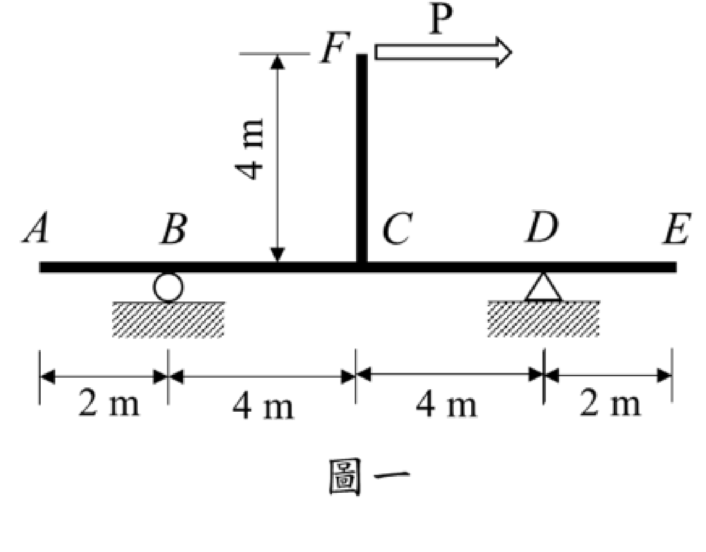

# SA-2023-1 題目正本

> 本檔只記錄考卷上寫了什麼、圖上畫了什麼，不含任何解法。解析見同資料夾 `SA-2023-1.md`。
> 判讀清單經使用者確認前，狀態為「待確認」；確認後本檔原則上不再修改（改動須回考卷原圖並記 log）。

| 項目 | 內容 |
|---|---|
| 考卷 | `raw/exams/SA-2023_結構學.pdf`，第 1 頁（頁次 2－1），第一題（圖一） |
| 考年 | 2023（民國 112 年）專技高考結構工程技師「結構學」 |
| 配分 | 25 分 |
| 附圖 | `SA-2023-1-fig-2.png`（本次從考卷擷取 500 dpi；既有 `SA-2023-1-fig-1.png` 保留） |
| 判讀狀態 | **已確認**（2026-11-07 使用者確認；原轉錄：2026-11-07 轉錄；PyMuPDF 110 dpi 整頁＋450 dpi 局部放大（附圖為內嵌點陣圖）；盲讀於開啟解析前完成） |

## 1. 考卷原文（逐字）

一、試分析一平面構架如圖一所示，點D 為鉸支承，點B 為滾支承，假設所有桿件之彈性模數與斷面慣性矩乘積為EI = 20,000 kN-m²。若構架中點D 支承下陷3 mm 情況下，為使點E 垂直向位移為零，試求應在點F 施加之水平力P 大小為何？（25 分）

## 2. 考卷給的公式、附表與參數

- 給定：所有桿件 EI＝20,000 kN-m²；D 支承下陷 3 mm。
- 考卷沒有給 EA（軸向變形未提及）。
- 卷首注意事項：㈠可以使用電子計算器。㈡不必抄題，作答時請將試題題號及答案依照順序寫在試卷上，於本試題上作答者，不予計分。㈢本科目除專門名詞或數理公式外，應使用本國文字作答。
- 考試時間：2 小時。代號 00340，頁次 2－1、2－2。

## 3. 附圖

*證據圖 SA-2023-1-fig-2.png（500 dpi，自考卷擷取；舊證據圖 SA-2023-1-fig-1.png 有游標雜訊，保留不改）*

圖面文字照錄：F、P、4 m、A、B、C、D、E、2 m、4 m、4 m、2 m、圖一

## 4. 判讀清單

| # | 項目 | 判讀 | 圖上／題文依據 | 把握 |
|---|---|---|---|---|
| 1 | 支承 | B 滾支承（圓圈）；D 鉸支承（三角形） | 450 dpi 放大＋題文 | 確定 |
| 2 | 梁尺寸 | AB＝2、BC＝4、CD＝4、DE＝2 m（A、E 為懸臂端） | 尺寸線刻度對齊 A、B、C、D、E | 確定 |
| 3 | 柱 | CF 垂直向上，高 4 m，於 C 與梁剛接（T 形連接） | 4 m 尺寸線上端對齊 F、下端對齊梁頂 | 確定（解讀）；使用者確認 |
| 4 | 載重 | F 點水平向右 P | 空心箭頭自 F 向右 | 確定 |
| 5 | 支承沉陷 | D 下陷 3 mm | 題文 | 確定 |
| 6 | 條件 | E 點垂直位移為零 | 題文 | 確定 |
| 7 | 靜定性 | 滾＋鉸共 3 個反力，靜定 | 計數 | 確定（解讀）；使用者確認 |
| 8 | 考卷沒有給 | EA、其他載重 | 題文 | 確定 |
| 9 | 所求 | 所需水平力 P 大小 | 題文 | 確定 |
| 10 | 證據圖 | 既有 fig-1 左側有游標（未壓到構件）；另擷取 500 dpi 乾淨版 fig-2 | 縮圖總表 | 確定 |

---
*轉錄：2026-11-07（SA 剩餘單元（U1-2 尾段、U2-5、U3-1、U3-2）題目正本推廣・批 1）*
*確認：2026-11-07 使用者確認*
