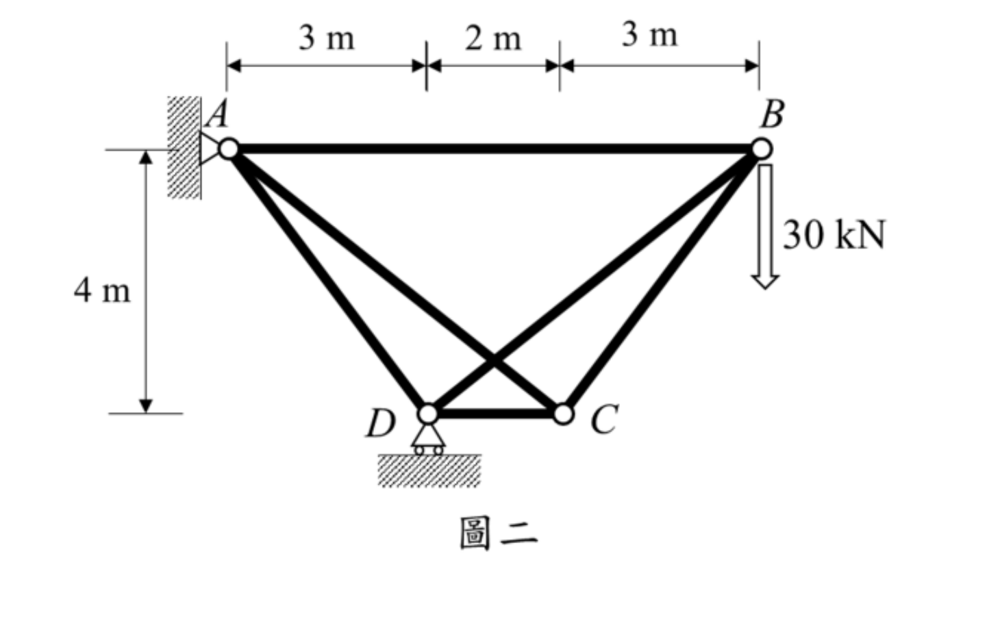

# SA-2023-2 題目正本

> 本檔只記錄考卷上寫了什麼、圖上畫了什麼，不含任何解法。解析見同資料夾 `SA-2023-2.md`。
> 判讀清單經使用者確認前，狀態為「待確認」；確認後本檔原則上不再修改（改動須回考卷原圖並記 log）。

| 項目 | 內容 |
|---|---|
| 考卷 | `raw/exams/SA-2023_結構學.pdf`，第 1 頁（正面），第二題（圖二） |
| 考年 | 2023（民國 112 年）專技高考結構工程技師「結構學」 |
| 配分 | 25 分 |
| 附圖 | `SA-2023-2-fig-1.png` |
| 判讀狀態 | **已確認**（2026-11-07 使用者確認；原轉錄：2026-11-07 轉錄；PyMuPDF 110 dpi 整頁＋400–1200 dpi 局部放大（附圖為內嵌點陣圖）；盲讀於開啟解析前完成） |

## 1. 考卷原文（逐字）

二、試分析一平面桁架如圖二所示，點A 為鉸支承，點D 為滾支承，假設所有桿件之彈性模數與斷面積乘積為EA=200,000 kN。若桁架中點B 承受一垂直載重30 kN ，試求桿件BD 中之內力並標註受壓或受拉。（25 分）

## 2. 考卷給的公式、附表與參數

- 考卷沒有給任何參考公式或附表。
- 給定：所有桿件 EA＝200,000 kN。
- 卷首注意事項：㈠可以使用電子計算器。㈡不必抄題，作答時請將試題題號及答案依照順序寫在試卷上，於本試題上作答者，不予計分。㈢本科目除專門名詞或數理公式外，應使用本國文字作答。
- 考試時間：2 小時。代號 00340，頁次 2－1。

## 3. 附圖

*證據圖 SA-2023-2-fig-1.png*

圖面文字照錄：3 m、2 m、3 m、A、B、30 kN、4 m、D、C、圖二

## 4. 判讀清單

| # | 項目 | 判讀 | 圖上／題文依據 | 把握 |
|---|---|---|---|---|
| 1 | A | 鉸支承於左側直立牆（三角形＋圓圈） | 500 dpi 放大；題文 | 確定 |
| 2 | D | 滾支承於水平地面（圓圈＋三角形＋兩滾輪）→ 垂直反力 | 500 dpi 放大；題文 | 確定 |
| 3 | 節點座標 | A(0,0)、B(8,0)、D(3,−4)、C(5,−4) | 上方 3 m｜2 m｜3 m 界線對齊 A、D、C、B；4 m 界線對齊 A 與 D、C | 確定 |
| 4 | 桿件 | A–B、A–D、A–C、B–D、B–C、D–C 共 6 根 | 圖面 | 確定 |
| 5 | 交叉處 | A–C 與 B–D 在圖上交叉，但交叉點**沒有節點**（無圓圈），兩桿互不相連 | 500 dpi 放大：交叉處無空心圓 | 確定 |
| 6 | 材料 | 所有桿件 EA＝200,000 kN | 題文 | 確定 |
| 7 | 載重 | B 點垂直向下 30 kN | 空心箭頭自 B 向下 | 確定 |
| 8 | 所求 | 桿 BD 內力（標註拉或壓） | 題文 | 確定 |
| 9 | 靜不定度 | m＝6、r＝3、j＝4：9＞8，一度靜不定 | 計數 | 確定（解讀）；使用者確認 |
| 10 | 證據圖 | fig-1 清晰無游標，沿用 | — | 確定 |

---
*轉錄：2026-11-07（SA-U2-2 題目正本推廣・批 1）*
*確認：2026-11-07 使用者確認*
