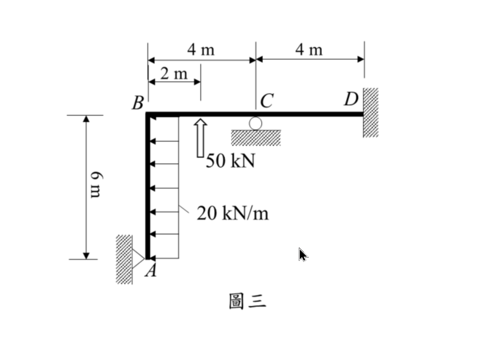
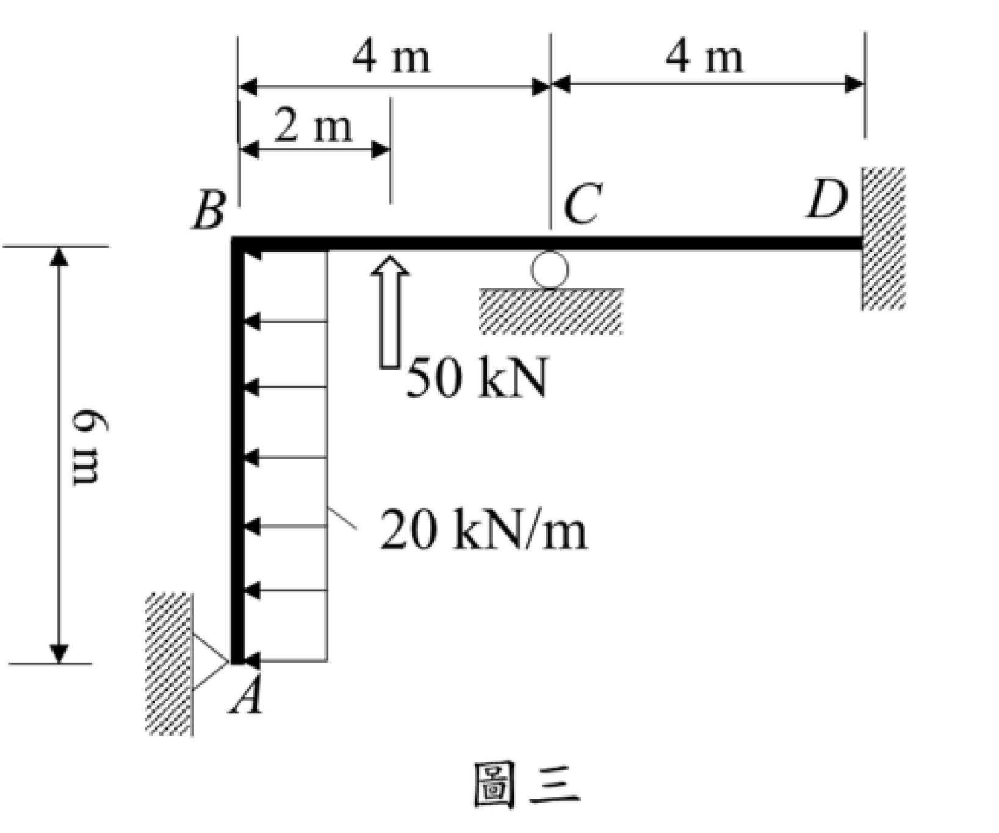

# SA-2023-3 題目正本

> 本檔只記錄考卷上寫了什麼、圖上畫了什麼，不含任何解法。解析見同資料夾 `SA-2023-3.md`。
> 判讀清單經使用者確認前，狀態為「待確認」；確認後本檔原則上不再修改（改動須回考卷原圖並記 log）。

| 項目 | 內容 |
|---|---|
| 考卷 | `raw/exams/SA-2023_結構學.pdf`，第 2 頁上半，第三題（圖三） |
| 考年 | 2023（民國 112 年）專技高考結構工程技師「結構學」 |
| 配分 | 25 分 |
| 附圖 | `SA-2023-3-fig-1.png`、`SA-2023-3-fig-2.png` |
| 判讀狀態 | **待確認**（2026-11-05 轉錄；PyMuPDF 110 dpi 整頁＋500 dpi 局部放大（附圖在 PDF 內為點陣圖，原始 462×419 像素）；盲讀於開啟解析前完成） |

## 1. 考卷原文（逐字）

三、圖三為一平面構架，點 D 為固定支承，點 A 為鉸支承，點 C 為滾支承，此構架點 A 至 B 間梁桿件承受一水平向均佈載重 20 kN/m，且點 B 至 C 間梁桿件中央承受一垂直集中載重 50 kN。設所有桿件 EI 為定值，且忽略桿件軸向變形，試用傾角變位法，求各桿件端點彎矩及各支承之反力。（25 分）

## 2. 考卷給的公式、附表與參數

- 考卷沒有給任何參考公式或附表。
- 題文稱 AB 為「梁桿件」，實為垂直柱（照考卷原文）。
- 題文只說 50 kN 為「垂直」載重，沒有寫向上或向下。
- 卷首注意事項：㈠可以使用電子計算器。㈡不必抄題，作答時請將試題題號及答案依照順序寫在試卷上，於本試題上作答者，不予計分。㈢本科目除專門名詞或數理公式外，應使用本國文字作答。
- 考試時間：2 小時。

## 3. 附圖

*證據圖 SA-2023-3-fig-1.png*

*證據圖 SA-2023-3-fig-2.png（2026-11-05 自考卷重新擷取 500 dpi，無游標）*

圖面文字照錄：4 m、4 m、2 m、B、C、D、6 m、50 kN、20 kN/m、A、圖三

## 4. 判讀清單

| # | 項目 | 判讀 | 圖上／題文依據 | 把握 |
|---|---|---|---|---|
| 1 | A | 鉸支承（三角形接左側垂直牆） | 三角形尖端指向 A、底邊貼剖線牆；題文 | 確定 |
| 2 | C | 滾支承（垂直反力） | 梁下圓圈＋水平剖線；題文 | 確定 |
| 3 | D | 固定支承（右側垂直牆） | 剖線牆；題文 | 確定 |
| 4 | B | 剛接節點 | 無鉸圈 | 確定 |
| 5 | 幾何 | AB 垂直 6 m；BC 水平 4 m；CD 水平 4 m | 左側 6 m；上方 4 m＋4 m 尺寸線 | 確定 |
| 6 | 剛度 | 所有桿件 EI 相同 | 題文 | 確定 |
| 7 | 均布載重 | 20 kN/m 水平向左，A 至 B 全高 | 箭頭由右側指向柱、箭頭頭部在柱上 | 確定 |
| 8 | 集中載重位置 | 距 B 2 m（BC 中點） | 上方 2 m 尺寸線右端對齊箭頭 | 確定 |
| 9 | 集中載重方向 | 50 kN 向上（空心箭頭在梁下方、箭頭頭部朝上頂住梁） | 500 dpi：箭頭尖端在上、貼梁底；題文只說「垂直」 | 不確定（影響答案，請確認） |
| 10 | 軸向變形 | 忽略 | 題文 | 確定 |
| 11 | 指定方法 | 傾角變位法 | 題文（未寫他法不給分） | 確定 |
| 12 | 所求 | 各桿件端點彎矩；各支承反力 | 題文 | 確定 |
| 13 | 證據圖 | 舊 fig-1 有滑鼠游標（空白處）；新增 fig-2（500 dpi） | — | 確定 |

---
*轉錄：2026-11-05（SA-U2-3 題目正本推廣・批 2）*
