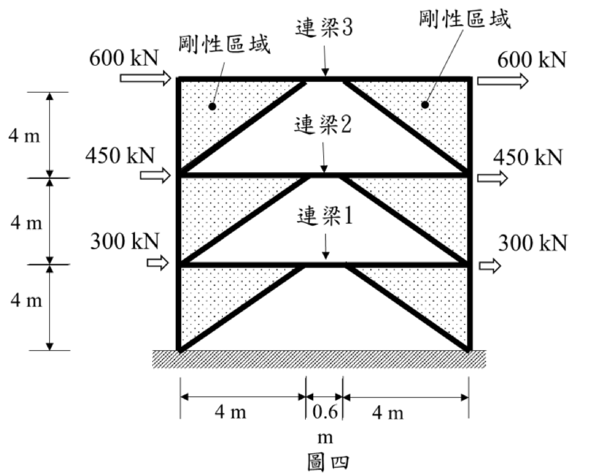

# SA-2023-4 題目正本

> 本檔只記錄考卷上寫了什麼、圖上畫了什麼，不含任何解法。解析見同資料夾 `SA-2023-4.md`。
> 判讀清單經使用者確認前，狀態為「待確認」；確認後本檔原則上不再修改（改動須回考卷原圖並記 log）。

| 項目 | 內容 |
|---|---|
| 考卷 | `raw/exams/SA-2023_結構學.pdf`，第 2 頁（頁次 2－2），第四題（圖四） |
| 考年 | 2023（民國 112 年）專技高考結構工程技師「結構學」 |
| 配分 | 25 分 |
| 附圖 | `SA-2023-4-fig-2.png`（本次從考卷擷取 500 dpi；既有 `SA-2023-4-fig-1.png` 保留） |
| 判讀狀態 | **已確認**（2026-11-07 使用者確認；原轉錄：2026-11-07 轉錄；PyMuPDF 110 dpi 整頁＋400 dpi 局部放大（附圖為內嵌點陣圖）；盲讀於開啟解析前完成） |

## 1. 考卷原文（逐字）

四、如圖四所示之三層樓平面結構，各樓層樓板承受不同的水平力，由下而上依序為300、450 及600 kN 分別施加於各樓層樓板之兩端。構架中配置斜撐桿件，斜撐與梁桿件於梁桿件中央處連接位置留有間距，並定義此部分為「連梁」桿件，連梁與梁桿件之斷面相同且為連續。構架中梁、柱與斜撐所形成之三角型區域勁度相對較大，可視為剛性區域，而各樓層連梁桿件之剛度皆為EI。若於該受力情況下構架頂端之水平側向位移為6 cm 時，不需經過精確分析，試推估各樓層連梁桿件端部旋轉變形角為何？（25 分）

## 2. 考卷給的公式、附表與參數

- 給定：頂端水平側向位移 6 cm；各層連梁剛度皆為 EI（無數值）。
- 考卷沒有給柱、斜撐斷面（三角區視為剛性）。
- 卷首注意事項：㈠可以使用電子計算器。㈡不必抄題，作答時請將試題題號及答案依照順序寫在試卷上，於本試題上作答者，不予計分。㈢本科目除專門名詞或數理公式外，應使用本國文字作答。
- 考試時間：2 小時。代號 00340，頁次 2－1、2－2。

## 3. 附圖

*證據圖 SA-2023-4-fig-2.png（500 dpi，自考卷擷取；舊證據圖 SA-2023-4-fig-1.png 有游標雜訊，保留不改）*

圖面文字照錄：剛性區域、連梁3、剛性區域、600 kN、600 kN、連梁2、450 kN、450 kN、連梁1、300 kN、300 kN、4 m、4 m、4 m、4 m、0.6 m、4 m、圖四

## 4. 判讀清單

| # | 項目 | 判讀 | 圖上／題文依據 | 把握 |
|---|---|---|---|---|
| 1 | 層高 | 三層各 4 m（共 12 m） | 左側尺寸線三段 4 m；頂段上端略高於屋頂梁，視為量到屋頂梁 | 確定（解讀）；使用者確認 |
| 2 | 跨度 | 4 m＋0.6 m＋4 m＝8.6 m；中央 0.6 m 為連梁長度 e | 下方尺寸線 | 確定 |
| 3 | 斜撐 | 每層兩根，自該層下緣（樓板或地面）的左右角點，斜向上連到上方梁中央連梁的兩端 | 400 dpi 放大 | 確定 |
| 4 | 連梁編號 | 連梁1 在一樓梁（第 1 層頂）、連梁2 在二樓梁、連梁3 在屋頂梁 | 標字箭頭各指向該層梁中央 | 確定 |
| 5 | 剛性區域 | 梁、柱、斜撐圍成的上方兩角三角形（網點區） | 題文＋網點 | 確定 |
| 6 | 載重 | 各樓層樓板左右兩端各一個向右空心箭頭，標字：一樓 300 kN、二樓 450 kN、屋頂 600 kN；兩端各標一次（是每端該值或兩端合計，題文未明說；層剪力比例不受影響） | 題文「分別施加於各樓層樓板之兩端」＋圖面兩端各標一次 | 確定（解讀）；使用者確認 |
| 7 | 柱底 | 落在地面剖線，未畫支承符號 | 圖面 | 確定（解讀）；使用者確認 |
| 8 | 頂層側移 | 6 cm | 題文 | 確定 |
| 9 | 考卷沒有給 | EI 數值、柱與斜撐斷面、柱底支承型式 | 題文 | 確定 |
| 10 | 所求 | 各樓層連梁端部旋轉變形角（推估，不需精確分析） | 題文 | 確定 |
| 11 | 證據圖 | 既有 fig-1 左上角有游標；另擷取 500 dpi 乾淨版 fig-2 | 縮圖總表 | 確定 |

---
*轉錄：2026-11-07（SA 剩餘單元（U1-2 尾段、U2-5、U3-1、U3-2）題目正本推廣・批 1）*
*確認：2026-11-07 使用者確認*
