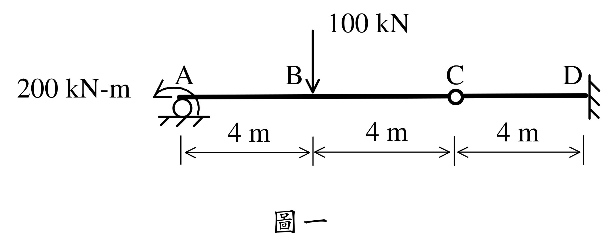

# SA-2024-1 題目正本

> 本檔只記錄考卷上寫了什麼、圖上畫了什麼，不含任何解法。解析見同資料夾 `SA-2024-1.md`。
> 判讀清單經使用者確認前，狀態為「待確認」；確認後本檔原則上不再修改（改動須回考卷原圖並記 log）。

| 項目 | 內容 |
|---|---|
| 考卷 | `raw/exams/SA-2024_結構學.pdf`，第 1 頁（頁次 2－1），第一題（圖一） |
| 考年 | 2024（民國 113 年）專技高考結構工程技師「結構學」 |
| 配分 | 25 分 |
| 附圖 | `SA-2024-1-fig-2.png`（本次從考卷擷取 500 dpi；既有 `SA-2024-1-fig-1.png` 保留） |
| 判讀狀態 | **已確認**（2026-11-07 使用者確認；原轉錄：2026-11-07 轉錄；PyMuPDF 110 dpi 整頁＋500 dpi 局部放大（附圖為向量圖）；盲讀於開啟解析前完成） |

## 1. 考卷原文（逐字）

一、如圖一所示之梁，假設斷面EI 值為常數。不論向下之位移或是向上之位移，其最大值都不能超過梁長之1/300，也就是最大容許位移值=40 mm。試求滿足該位移限制之最小EI 值。（25 分）

## 2. 考卷給的公式、附表與參數

- 給定：EI 常數；最大容許位移 40 mm（＝梁長 12 m 的 1/300），向上、向下皆適用。
- 卷首注意事項：㈠可以使用電子計算器。㈡不必抄題，作答時請將試題題號及答案依照順序寫在試卷上，於本試題上作答者，不予計分。㈢本科目除專門名詞或數理公式外，應使用本國文字作答。
- 考試時間：2 小時。代號 00340，頁次 2－1、2－2。

## 3. 附圖

*證據圖 SA-2024-1-fig-2.png（500 dpi，自考卷擷取；舊證據圖 SA-2024-1-fig-1.png 有游標雜訊，保留不改）*

圖面文字照錄：100 kN、200 kN-m、A、B、C、D、4 m、4 m、4 m、圖一

## 4. 判讀清單

| # | 項目 | 判讀 | 圖上／題文依據 | 把握 |
|---|---|---|---|---|
| 1 | A 支承 | 滾支承（圓圈＋地面剖線） | 500 dpi 放大 | 確定 |
| 2 | A 端彎矩 | 200 kN-m，逆時針（弧形箭頭自右下繞上方，箭頭指向左下） | 500 dpi 放大 | 確定 |
| 3 | B 載重 | 100 kN 向下，距 A 4 m | 箭頭對齊第一個 4 m 刻度 | 確定 |
| 4 | C | 內鉸（梁上空心圓），距 A 8 m | 500 dpi 放大 | 確定 |
| 5 | D | 固定端（右側直立剖線） | 500 dpi 放大 | 確定 |
| 6 | 尺寸 | AB＝BC＝CD＝4 m，梁長 12 m | 尺寸線 | 確定 |
| 7 | 位移限制 | 向上、向下最大值皆 ≤ 40 mm | 題文 | 確定 |
| 8 | 考卷沒有給 | E、I 個別數值 | 題文 | 確定 |
| 9 | 所求 | 最小 EI | 題文 | 確定 |
| 10 | 證據圖 | 既有 fig-1 下方有 I 形游標（未壓到構件）；另擷取 500 dpi 乾淨版 fig-2 | 縮圖總表 | 確定 |

---
*轉錄：2026-11-07（SA 剩餘單元（U1-2 尾段、U2-5、U3-1、U3-2）題目正本推廣・批 1）*
*確認：2026-11-07 使用者確認*
