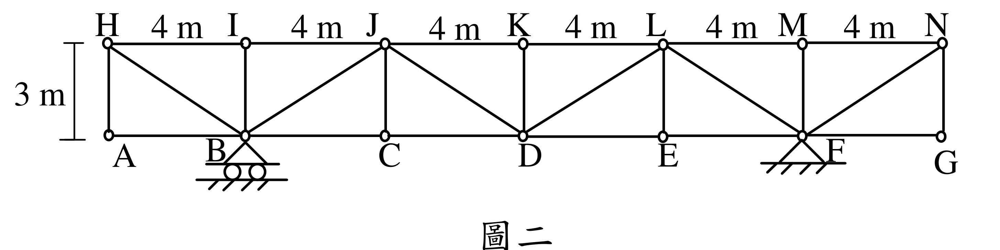

# SA-2024-2 題目正本

> 本檔只記錄考卷上寫了什麼、圖上畫了什麼，不含任何解法。解析見同資料夾 `SA-2024-2.md`。
> 判讀清單經使用者確認前，狀態為「待確認」；確認後本檔原則上不再修改（改動須回考卷原圖並記 log）。

| 項目 | 內容 |
|---|---|
| 考卷 | `raw/exams/SA-2024_結構學.pdf`，第 1 頁（頁次 2－1），第二題（圖二） |
| 考年 | 2024（民國 113 年）專技高考結構工程技師「結構學」 |
| 配分 | 25 分 |
| 附圖 | `SA-2024-2-fig-2.png`（本次從考卷擷取 500 dpi；既有 `SA-2024-2-fig-1.png` 保留） |
| 判讀狀態 | **已確認**（2026-11-07 使用者確認；原轉錄：2026-11-07 轉錄；PyMuPDF 110 dpi 整頁＋500 dpi 局部放大（附圖為向量圖）；盲讀於開啟解析前完成） |

## 1. 考卷原文（逐字）

二、如圖二所示之桁架，已知支承F 發生垂直向下沉陷v_F = 12 mm，桿件CD 有製造誤差δ，桿件DE 有溫差ΔT。因以上三個原因，造成C 點向下位移4.8 mm，E 點向下位移6.4 mm。試求上述製造誤差δ = ？mm（註明過長或過短）及ΔT = ？℃（註明升溫或降溫）；假設所有桁架桿件性質相同如下：熱膨脹係數α = 1.5×10⁻⁵ /℃，楊氏模數100 GPa，斷面積A=150 mm²。（25 分）

## 2. 考卷給的公式、附表與參數

- 給定：α＝1.5×10⁻⁵ /℃、E＝100 GPa、A＝150 mm²（所有桿件相同）。
- 給定：v_F＝12 mm 向下；C 點向下 4.8 mm、E 點向下 6.4 mm。
- 考卷沒有給任何外力載重。
- 卷首注意事項：㈠可以使用電子計算器。㈡不必抄題，作答時請將試題題號及答案依照順序寫在試卷上，於本試題上作答者，不予計分。㈢本科目除專門名詞或數理公式外，應使用本國文字作答。
- 考試時間：2 小時。代號 00340，頁次 2－1、2－2。

## 3. 附圖

*證據圖 SA-2024-2-fig-2.png（500 dpi，自考卷擷取；舊證據圖 SA-2024-2-fig-1.png 有游標雜訊，保留不改）*

圖面文字照錄：H、I、J、K、L、M、N、4 m（六處）、3 m、A、B、C、D、E、F、G、圖二

## 4. 判讀清單

| # | 項目 | 判讀 | 圖上／題文依據 | 把握 |
|---|---|---|---|---|
| 1 | 座標 | 下弦 A、B、C、D、E、F、G 在 x＝0、4、…、24 m，y＝0；上弦 H～N 同 x、y＝3 m | 上弦 4 m×6、高 3 m 尺寸 | 確定 |
| 2 | 支承 | B 滾支承（三角形下兩滾輪）；F 鉸支承（三角形＋剖線） | 500 dpi 放大 | 確定 |
| 3 | 上下弦 | 上弦 HI…MN 6 根、下弦 AB…FG 6 根 | 圖面 | 確定 |
| 4 | 垂直桿 | HA、IB、JC、KD、LE、MF、NG 共 7 根 | 500 dpi 放大 | 確定 |
| 5 | 斜桿 | H–B、B–J、J–D、D–L、L–F、F–N 共 6 根（自 B、D、F 向兩側上弦呈 V 形） | 500 dpi 放大 | 確定 |
| 6 | 靜定性 | m＝25、r＝3、j＝14：28＝28，靜定 | 計數 | 確定（解讀）；使用者確認 |
| 7 | 三個原因 | F 沉陷 12 mm 向下、CD 製造誤差 δ、DE 溫差 ΔT；無外力 | 題文 | 確定 |
| 8 | 量測值 | C 向下 4.8 mm、E 向下 6.4 mm | 題文 | 確定 |
| 9 | 材料 | α＝1.5×10⁻⁵/℃、E＝100 GPa、A＝150 mm² | 題文 | 確定 |
| 10 | 所求 | δ（mm，註明過長或過短）、ΔT（℃，註明升溫或降溫） | 題文 | 確定 |
| 11 | 證據圖 | 既有 fig-1 在 H 處有游標；另擷取 500 dpi 乾淨版 fig-2 | 縮圖總表 | 確定 |

---
*轉錄：2026-11-07（SA 剩餘單元（U1-2 尾段、U2-5、U3-1、U3-2）題目正本推廣・批 1）*
*確認：2026-11-07 使用者確認*
