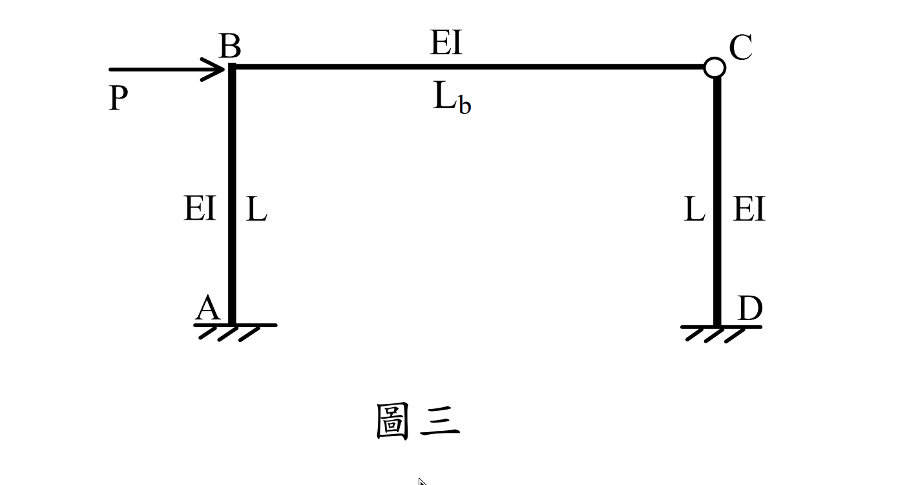

# SA-2024-3 題目正本

> 本檔只記錄考卷上寫了什麼、圖上畫了什麼，不含任何解法。解析見同資料夾 `SA-2024-3.md`。
> 判讀清單經使用者確認前，狀態為「待確認」；確認後本檔原則上不再修改（改動須回考卷原圖並記 log）。

| 項目 | 內容 |
|---|---|
| 考卷 | `raw/exams/SA-2024_結構學.pdf`，第 2 頁上半，第三題（圖三） |
| 考年 | 2024（民國 113 年）專技高考結構工程技師「結構學」 |
| 配分 | 25 分 |
| 附圖 | `SA-2024-3-fig-1.png` |
| 判讀狀態 | **已確認**（2026-11-07 使用者確認；影響答案項目定案：#3 C 為梁與右柱之間的內鉸（使用者 2026-11-05 確認，解析已於同日勘誤）。原轉錄：2026-11-05 轉錄；PyMuPDF 110 dpi 整頁＋500 dpi 局部放大；盲讀於開啟解析前完成） |

## 1. 考卷原文（逐字）

三、如圖三所示之門型構架，梁與柱之斷面 EI 皆相同，但梁長大於柱長，也就是 Lb / L > 1。已知兩根柱最大彎矩的數值大小與梁最大彎矩的數值大小其比為 2：1，試求此時 Lb / L = ？本題限以傾角變位法作答，分析時可忽略軸向變形。（25 分）

## 2. 考卷給的公式、附表與參數

- 考卷沒有給任何參考公式或附表。
- P、L、EI 皆無數值；所求為比值。
- 題文沒有提到 C 點的接合型式，只能由附圖判讀。
- 卷首注意事項：㈠可以使用電子計算器。㈡不必抄題，作答時請將試題題號及答案依照順序寫在試卷上，於本試題上作答者，不予計分。㈢本科目除專門名詞或數理公式外，應使用本國文字作答。
- 考試時間：2 小時。

## 3. 附圖

*證據圖 SA-2024-3-fig-1.png*

圖面文字照錄：P、B、EI、Lb、C、EI、L、L、EI、A、D、圖三

## 4. 判讀清單

| # | 項目 | 判讀 | 圖上／題文依據 | 把握 |
|---|---|---|---|---|
| 1 | A、D | 固定支承（柱底） | 柱底水平線下斜剖線，無三角形 | 確定 |
| 2 | B | 剛接角點 | 無鉸圈 | 確定 |
| 3 | C | 內鉸：梁 BC 與柱 CD 在 C 點鉸接 | C 角點畫空心圓（B 角沒有）；題文未提 | 確定（解讀）（影響答案，請確認）；使用者確認 |
| 4 | 幾何 | 柱 AB、DC 長 L；梁 BC 長 Lb，Lb/L > 1 | 圖標；題文 | 確定 |
| 5 | 剛度 | 三桿 EI 相同 | 圖標；題文 | 確定 |
| 6 | 載重 | B 點水平力 P 向右 | 箭頭指向 B | 確定 |
| 7 | 條件 | 兩柱最大彎矩（數值）：梁最大彎矩（數值）＝ 2：1 | 題文 | 確定（解讀）：取兩根柱中最大者與梁中最大者相比；使用者確認 |
| 8 | 軸向變形 | 可忽略 | 題文 | 確定 |
| 9 | 指定方法 | 傾角變位法（限用） | 題文 | 確定 |
| 10 | 所求 | Lb/L | 題文 | 確定 |

---
*轉錄：2026-11-05（SA-U2-3 題目正本推廣・批 2）*
*確認：2026-11-07 使用者確認*
