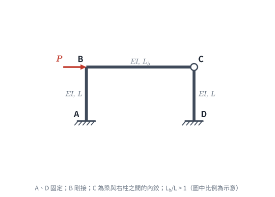

# 考題編號：SA-2024-3

**主分類：** `SA-U2-3` 靜不定結構分析
**副分類：** 無
**分析法：** 傾角變位法（含遠端鉸接修正式）
**標籤：** `傾角變位法`, `門型剛構架`, `對稱性`, `極值比例`, `內鉸`, `修正勁度`

---

## 1. 題目（考卷原文見題目正本）

> 考卷原文、公式／附表、附圖與判讀清單（已確認）見 [`SA-2024-3-problem.md`](SA-2024-3-problem.md)。本節只列解題時最容易讀錯的地方與本解使用的記號；題意以題目正本為準。

*重繪自考卷附圖，依判讀清單 #1–#10 重繪（L_b/L 比例為示意）。攔：漏讀 C 點內鉸。*

### 常見誤讀
| 項目 | 正確判讀 | 常見誤讀 |
|---|---|---|
| C 點 | 內鉸：梁 BC 與柱 CD 在 C 鉸接（C 角空心圓，B 角沒有） | 對稱門型剛架，令 $\theta_B = \theta_C$（本解 2026-11-05 前的版本） |
| 2：1 | 兩柱中最大彎矩：梁中最大彎矩 | 柱頂對梁端 |

**本解舊版曾犯：** 沒看到 C 角的空心圓，把構架當成左右對稱的門型剛架，令 $\theta_B=\theta_C$ 反對稱求解，得 $L_b/L = 3$。C 為內鉸時結構**不對稱**，$M_{BC}=M_{CB}=M_{CD}=0$ 的那一端要用 $3EI/L$ 修正式，答案是 $L_b/L = 3/2$。

**本解記號：** 桿端彎矩、節點轉角、弦轉角一律順時針為正；$\psi = \Delta/L$，$\Delta$ 為柱頂向右側移；$K_c = EI/L$，$k = L_b/L$。

---

## 2. 考題核心精神與出題者意圖 (Core Concepts & Examiner's Intent)
本題是「反向工程」題型：給定**內力比例條件**，要求反推**幾何參數**。
出題者旨在測驗考生：
1. **看圖判讀邊界**：門型構架看起來左右對稱，但 C 角畫了內鉸，B 角沒有——兩根柱的上端條件不同，**不能用反對稱變形 $\theta_B=\theta_C$**。
2. **遠端鉸接修正式**：梁 BC 的 C 端、柱 DC 的 C 端都是鉸，用 $3EI/L$ 修正式把未知轉角消掉，未知數只剩 $\theta_B$ 與 $\psi$。
3. **傾角變位法的代數操作**：在不代數值的情況下，以符號推導出各端點彎矩。
4. **彎矩極值的邏輯判斷**：比較兩根柱四個端點彎矩的大小，自行判斷「兩根柱最大彎矩」出現在哪裡，再套比例條件。

## 3. 解題戰略地圖與陷阱分析 (Strategic Roadmap & Trap Analysis)
1. **設定未知數**：
   - 令 $k = L_b / L$、$K_c = EI/L$，梁的線剛度 $EI/L_b = K_c/k$。
   - 未知量：$\theta_B$、側移角 $\psi$（兩柱等長、梁不計軸向變形，$\psi_{AB}=\psi_{DC}=\psi$，$\psi_{BC}=0$）。
   - C 為內鉸：$M_{BC}$ 的遠端、$M_{DC}$ 的遠端都是鉸 → 用修正式，不必設 $\theta_C$。
2. **建立傾角變位方程式**：$M_{AB}$、$M_{BA}$（一般式）、$M_{BC}$、$M_{DC}$（修正式），$M_{CB}=M_{CD}=0$。
3. **節點 B 平衡**：$\Sigma M_B = 0$，得 $\theta_B$ 與 $\psi$ 的比例，代回使所有彎矩皆為 $\psi$ 的倍數。
4. **極值判斷與求解**：
   - 梁無跨中載重，最大彎矩在端點：$|M_{BC}|$（C 端為 0）。
   - 柱無跨中載重，比較 $|M_{AB}|$、$|M_{BA}|$、$|M_{DC}|$（$M_{CD}=0$），找出最大者。
   - 比值條件只需要 $\theta$–$\psi$ 比例，**不需要**層剪力方程（$P$ 只決定 $\psi$ 的大小，比值與 $P$ 無關）。
5. **陷阱分析**：
   - **漏看 C 角內鉸**：照對稱門型剛架做 $\theta_B=\theta_C$，得 $L_b/L = 3$（舊版解析的錯誤）。
   - 誤用 $|M_{BA}|$ 當柱的最大值：節點 B 只有兩根桿，$|M_{BA}| = |M_{BC}|$ 必然成立，比例永遠 1:1，解不出來。
   - 只看左柱：右柱 $|M_{DC}|$ 也要比較；本題 $|M_{AB}| > |M_{DC}|$，最大值仍在左柱底。

## 3.5 變數層次分析 (Variable Hierarchy Analysis)

### 最終目標
以傾角變位法導出柱與梁最大彎矩的代數式，並透過其比例為 2，反求 $k = L_b/L$。

### 本題關鍵公式（依計算順序）
$$ M_{ij} = \frac{2EI}{L} (2\theta_i + \theta_j - 3\psi) + FEM_{ij} \quad \text{(傾角變位法基本式)} $$
$$ M_{ij} = \frac{3EI}{L} (\theta_i - \psi) + \overline{FEM}_{ij} \quad \text{(遠端 j 為鉸接之修正式)} $$
$$ \Sigma M_B = M_{BA} + M_{BC} = 0 \quad \text{(節點平衡)} $$
$$ \frac{|M_{col,max}|}{|M_{beam,max}|} = 2 \quad \text{(題設條件)} $$

### L1：題目直接給定
| 符號 | 數值 | 說明 |
|---|---|---|
| $K_c$ | $EI/L$ | 柱線剛度 |
| $EI/L_b$ | $K_c/k$ | 梁線剛度 |
| $\theta_A, \theta_D$ | $0$ | 固定端邊界條件 |
| $M_{CB}, M_{CD}$ | $0$ | C 為內鉸（附圖空心圓） |
| $FEM_{ij}$ | $0$ | 桿件上無載重（P 為節點載重） |

### L2：需知識點推導
| 符號 | 公式／來源 | 卡關? |
|---|---|---|
| $M_{AB}, M_{BA}$ | 一般傾角變位式 | |
| $M_{BC}, M_{DC}$ | 遠端鉸接修正式 $3EI/L$ | |
| $\theta_B$ 與 $\psi$ 關係 | 節點 B 彎矩平衡方程式 | |

### L3：深層知識（不懂就卡住）
| 知識點 | 說明 | 卡關? |
|---|---|---|
| 圖上的空心圓 | C 角空心圓＝梁柱內鉸，兩桿在 C 端彎矩皆為零；結構因此不對稱，反對稱條件 $\theta_B=\theta_C$ 不成立 | |
| 極值判斷 | 要比較兩根柱共四個端點（其中 $M_{CD}=0$），證明 $|M_{AB}|$ 最大，才能列出正確的等式 | |

## 4. 步驟化詳細計算過程 (Step-by-Step Detailed Calculation)

### Step 1: 參數設定與變形條件
令比值 $k = \frac{L_b}{L}$，柱之線剛度 $K_c = \frac{EI}{L}$，梁之線剛度 $\frac{EI}{L_b} = \frac{K_c}{k}$。
未知量：節點 B 轉角 $\theta_B = \theta$、柱側移角 $\psi_{AB} = \psi_{DC} = \psi$；梁 $\psi_{BC} = 0$。
邊界條件：$\theta_A = \theta_D = 0$；C 為內鉸，$M_{CB} = M_{CD} = 0$。

### Step 2: 建立傾角變位方程式
$$ M_{AB} = 2K_c (\theta - 3\psi) $$
$$ M_{BA} = 2K_c (2\theta - 3\psi) $$
$$ M_{BC} = 3\left(\frac{K_c}{k}\right)\theta \quad \text{（C 端鉸接修正式）} $$
$$ M_{DC} = 3K_c (0 - \psi) = -3K_c\psi \quad \text{（C 端鉸接修正式）} $$
$$ M_{CB} = M_{CD} = 0 $$

### Step 3: 節點平衡與代換
於節點 B 取力矩平衡：
$$ \Sigma M_B = 0 \implies M_{BA} + M_{BC} = 0 $$
$$ 2K_c (2\theta - 3\psi) + \frac{3K_c}{k}\theta = 0 $$
$$ \left(4 + \frac{3}{k}\right)\theta = 6\psi \implies \theta = \frac{6k}{4k+3}\psi $$

### Step 4: 用 $\psi$ 表示各端點彎矩
$$ M_{BC} = \frac{3K_c}{k} \cdot \frac{6k}{4k+3}\psi = \frac{18K_c}{4k+3}\psi, \qquad M_{BA} = -M_{BC} = -\frac{18K_c}{4k+3}\psi $$
$$ M_{AB} = 2K_c \left( \frac{6k}{4k+3} - 3 \right)\psi = -\frac{6(2k+3)K_c}{4k+3}\psi $$
$$ M_{DC} = -3K_c\psi = -\frac{3(4k+3)K_c}{4k+3}\psi $$

梁 BC 無跨中載重，彎矩圖為直線且 C 端為零，故梁的最大彎矩為：
$$ |M_{beam,max}| = |M_{BC}| = \frac{18K_c}{4k+3}|\psi| $$

### Step 5: 判斷柱的最大彎矩並求解 $k$
兩根柱無跨中載重，最大彎矩在端點。比較分子（共同分母 $4k+3$）：
- 左柱底 $|M_{AB}|$：$6(2k+3) = 12k + 18$
- 左柱頂 $|M_{BA}|$：$18$
- 右柱底 $|M_{DC}|$：$3(4k+3) = 12k + 9$
- 右柱頂 $M_{CD} = 0$

$k > 0$ 時 $12k + 18$ 恆為最大，故兩根柱的最大彎矩發生在**左柱底 A**：
$$ |M_{col,max}| = |M_{AB}| = \frac{6(2k+3)K_c}{4k+3}|\psi| $$

依據題目條件「兩根柱最大彎矩與梁最大彎矩大小其比為 2：1」：
$$ \frac{|M_{AB}|}{|M_{BC}|} = \frac{6(2k+3)}{18} = \frac{2k+3}{3} = 2 \implies 2k + 3 = 6 \implies k = \frac{3}{2} $$
$$ \boxed{\frac{L_b}{L} = \frac{3}{2} = 1.5} $$

### Step 6: 驗算（補上層剪力方程求實際彎矩值）
不計軸向變形，梁 BC 為兩柱頂共同的水平繫桿；取柱頂以上自由體，水平力平衡：
$$ P = -\frac{M_{AB}+M_{BA}}{L} - \frac{M_{DC}+M_{CD}}{L} \implies PL = \frac{3(8k+15)}{4k+3}K_c\psi $$
代入 $k = 3/2$：$PL = 9K_c\psi$，即 $K_c\psi = PL/9$，各端點彎矩：

| 端點 | 彎矩 |
|---|---|
| $M_{AB}$ | $-\tfrac{4}{9}PL$ |
| $M_{BA}$ | $-\tfrac{2}{9}PL$ |
| $M_{BC}$ | $+\tfrac{2}{9}PL$ |
| $M_{CB}$、$M_{CD}$ | $0$ |
| $M_{DC}$ | $-\tfrac{1}{3}PL$ |

- 柱最大 $\tfrac49 PL$ ÷ 梁最大 $\tfrac29 PL$ $= 2$ ✓
- 節點 B：$M_{BA} + M_{BC} = 0$ ✓
- 層剪力：$-(M_{AB}+M_{BA}+M_{DC})/L = (\tfrac49+\tfrac29+\tfrac13)P = P$ ✓
- $k = 1.5 > 1$ ✓ 符合題目前提

## 5. 關鍵爭議點與進階探討 (Critical Issues & Advanced Discussion)
- **C 角是內鉸還是剛接**：題文沒提，只有附圖 C 角的空心圓（B 角沒有）。若誤當成剛接的對稱門型剛架，反對稱條件 $\theta_B = \theta_C$ 成立，比值為 $(k+3)/3$，得 $L_b/L = 3$；本解依附圖取內鉸，比值為 $(2k+3)/3$，得 $L_b/L = 3/2$。兩種讀法答案差一倍，作答時應先寫明判讀。
- **「兩根柱最大彎矩」的讀法**：內鉸使兩根柱的彎矩不再相同。本解取兩根柱中最大者（左柱底 $|M_{AB}|$）；若改取右柱的最大值 $|M_{DC}|$ 與梁比，則 $(4k+3)/6 = 2$，得 $k = 9/4$。前者是較自然的讀法。
- **柱底若為鉸支承**：A、D 改為鉸支承時，結構成為三鉸構架（A、C、D 三鉸），右柱 CD 為二力桿、彎矩為零；左柱最大彎矩只能是 $|M_{BA}| = |M_{BC}|$，比值恆為 1:1，不可能滿足 2:1。題目的固定端條件與答案自洽。

*修正日期：2026-11-05（解析勘誤：考卷附圖 C 角為內鉸（題目正本判讀 #3，使用者確認），舊版漏讀、當成對稱門型剛架以 θ_B = θ_C 反對稱求解；§1 圖說與常見誤讀、§2–§5 依內鉸重寫，答案 L_b/L 由 3 改為 3/2；驗證：符號推導與 2D 勁度法數值掃描 k = 1、1.5、2、3、10 逐點一致，比值 (2k+3)/3，k = 3/2 時各端點彎矩以層剪力方程回代，MISMATCHES: 0）*

*修正日期：2026-11-07（§1 改為指向題目正本並放重繪附圖（figs/SA-2024-3-fig-1-problem.svg）、加常見誤讀；原 §1 的勘誤引言併入「本解舊版曾犯」；圖由 gen_SA-2024-3.py 產生，可重跑）*
