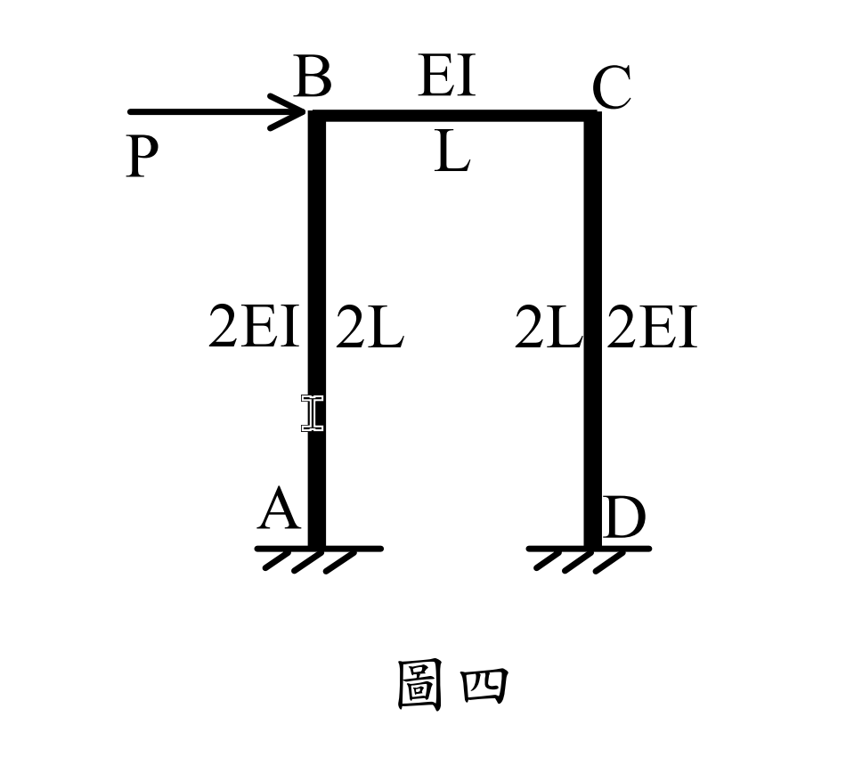
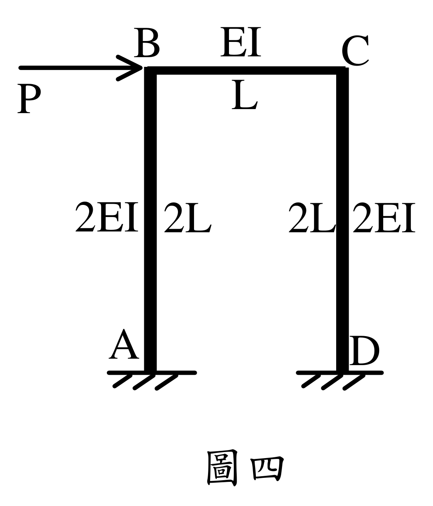

# SA-2024-4 題目正本

> 本檔只記錄考卷上寫了什麼、圖上畫了什麼，不含任何解法。解析見同資料夾 `SA-2024-4.md`。
> 判讀清單經使用者確認前，狀態為「待確認」；確認後本檔原則上不再修改（改動須回考卷原圖並記 log）。

| 項目 | 內容 |
|---|---|
| 考卷 | `raw/exams/SA-2024_結構學.pdf`，第 2 頁下半，第四題（圖四） |
| 考年 | 2024（民國 113 年）專技高考結構工程技師「結構學」 |
| 配分 | 25 分 |
| 附圖 | `SA-2024-4-fig-1.png`、`SA-2024-4-fig-2.png` |
| 判讀狀態 | **已確認**（2026-11-05 使用者確認；影響答案項目定案：解析答錯題，使用者決定依考卷整題重解（P−Δ 側推曲線，階段 C）。原轉錄：2026-11-05 轉錄；PyMuPDF 110 dpi 整頁＋250–800 dpi 局部放大、PDF 向量座標；盲讀於開啟解析前完成） |

## 1. 考卷原文（逐字）

四、如圖四所示之門型構架，試以結構勁度矩陣法求取側推曲線 P−Δ 圖，直至結構到達極限承載力，其中 Δ 為受力點之側向（水平）位移。假設 EI = 425,000 kN-m²，L = 7 m，梁斷面塑性彎矩強度 Mpb = 300 kN-m，柱斷面塑性彎矩強度 Mpc = 580 kN-m，上述梁、柱之彎矩強度不論正負彎矩都相同。分析時可忽略軸向變形，且當桿件之斷面到達彎矩強度前，桿件維持彈性；當桿件之斷面到達彎矩強度時，該斷面以塑鉸模擬且斷面之彎矩維持不變（具韌性但不考慮應變硬化）。（25 分）

## 2. 考卷給的公式、附表與參數

- 考卷沒有給任何參考公式或附表。
- EI = 425,000 kN-m²、L = 7 m、Mpb = 300 kN-m、Mpc = 580 kN-m（正負彎矩相同）；忽略軸向變形（題文）。
- 彈塑性模型：未達強度前彈性；到達後以塑鉸模擬、彎矩不變，不考慮應變硬化（題文）。
- 卷首注意事項：可以使用電子計算器。不必抄題，作答時請將試題題號及答案依照順序寫在試卷上，於本試題上作答者，不予計分。本科目除專門名詞或數理公式外，應使用本國文字作答。
- 考試時間：2 小時。

## 3. 附圖

*證據圖 SA-2024-4-fig-1.png*

*證據圖 SA-2024-4-fig-2.png（2026-11-05 自考卷重新擷取 500 dpi，無游標）*

圖面文字照錄：P、B、EI、C、L、2EI、2L、2L、2EI、A、D、圖四

## 4. 判讀清單

| # | 項目 | 判讀 | 圖上／題文依據 | 把握 |
|---|---|---|---|---|
| 1 | 幾何 | 柱 AB、DC 高 2L = 14 m；梁 BC 長 L = 7 m | 圖上標註＋題文 L = 7 m | 確定 |
| 2 | 撓曲剛度 | 柱 2EI、梁 EI；EI = 425,000 kN-m² | 圖上標註；題文 | 確定 |
| 3 | 節點 B、C | 剛接 | 附圖 | 確定 |
| 4 | 支承 A、D | 固定端 | 附圖剖線 | 確定 |
| 5 | 載重 | P 水平向右，作用於 B（梁柱接點） | 附圖箭頭指向 B | 確定 |
| 6 | 塑性彎矩 | 梁 Mpb = 300、柱 Mpc = 580 kN-m | 題文 | 確定 |
| 7 | 所求 | P−Δ 側推曲線至極限承載力（逐次形成塑鉸）；限結構勁度矩陣法 | 題文 | 確定 |
| 8 | 證據圖 | 舊截圖 fig-1：滑鼠游標（I 形）**壓在柱 AB 中段**；新增 fig-2（2026-11-05 自考卷重新擷取 500 dpi） | — | 確定 |

---
*轉錄：2026-11-05（SA-U2-4 題目正本推廣・批 1）*
*確認：2026-11-05 使用者確認*
