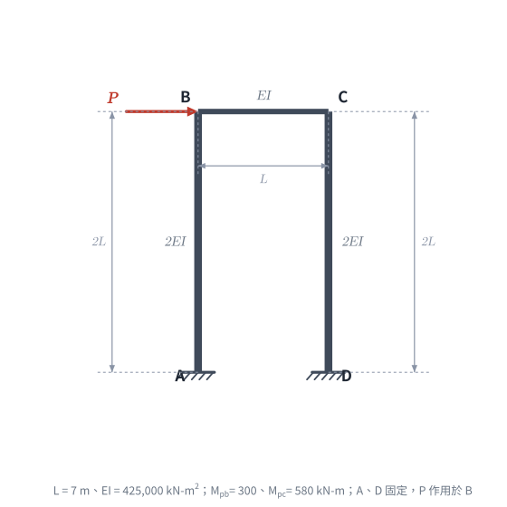
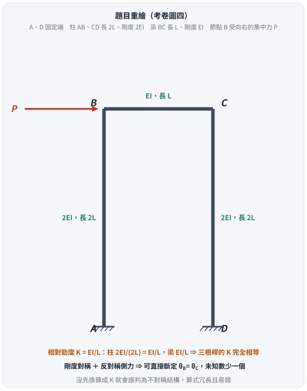
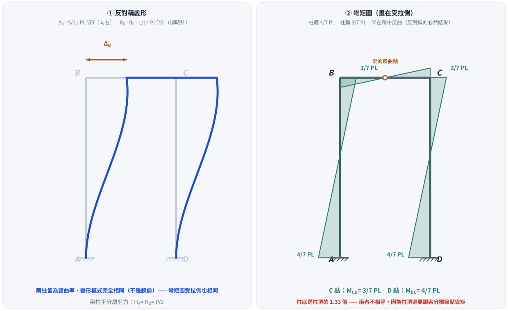
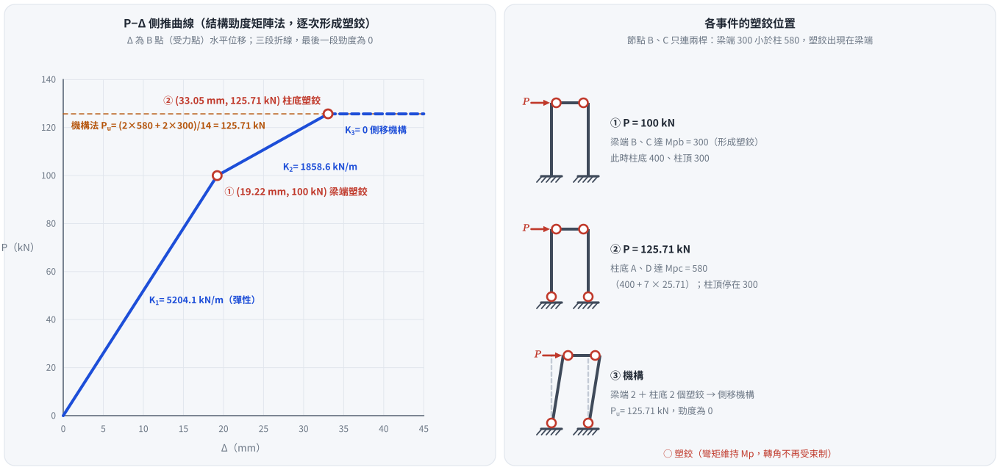

# 考題編號：SA-2024-4

**主分類：** `SA-U2-4` 靜不定結構之矩陣分析法
**副分類：** 無
**分析法：** 結構勁度矩陣法（彈塑性側推，逐次形成塑鉸）
**標籤：** `傾角變位法`, `剛架`, `側移`, `集中力`, `反對稱`, `非均勻斷面`, `側推分析`, `塑鉸`, `極限承載力`

---

## 1. 題目（考卷原文見題目正本）

> 考卷原文、公式／附表、附圖與判讀清單（已確認）見 [`SA-2024-4-problem.md`](SA-2024-4-problem.md)。本節只列解題時最容易讀錯的地方與本解使用的記號；題意以題目正本為準。

> **勘誤（2026-11-05）**：舊版 §2–§5 只做彈性階段（求 B 點位移與 C、D 彎矩），沒有回答考卷所求的 P−Δ 側推曲線，且未使用考卷給的 EI、L、Mpb、Mpc；已依題目正本整題重解（詳見頁尾修正日期）。

*重繪自考卷附圖，依判讀清單 #1–#8 重繪。攔：柱、梁的剛度或長度讀反、P 作用點讀錯。*

### 常見誤讀
| 項目 | 正確判讀 | 常見誤讀 |
|---|---|---|
| 所求 | 以結構勁度矩陣法求 P−Δ 側推曲線至極限承載力（逐次形成塑鉸） | 只求彈性階段的 B 點位移與 C、D 彎矩 |
| 考卷數值 | EI = 425,000 kN-m²、L = 7 m、Mpb = 300、Mpc = 580 kN-m | 未使用 |

**本解記號：** 自由度 Δ（B、C 共同水平位移，向右為正）、θ_B、θ_C（節點轉角，逆時針為正）；桿端彎矩以作用在桿端、逆時針為正，表中另註受拉側。數值單位 kN、m。

### 判讀圖解（解析自繪）

*圖 1　題目重繪（向量版）。這張圖攔的是「柱 $2EI$、梁 $EI$ 看起來不對稱」的第一印象：換算成相對勁度 $K = EI/L$ 之後，三根桿完全相等 —— 這是出題者刻意的設計，先看出來就能少算一半。*

## 2. 考題核心精神與出題者意圖 (Core Concepts & Examiner's Intent)
本題是**彈塑性側推（pushover）分析**的入門題：用結構勁度矩陣法，從彈性開始逐步加載，每當某一斷面的彎矩到達塑性彎矩強度，就在該處放一個塑鉸、修改勁度矩陣再繼續，直到結構形成機構（勁度矩陣奇異）為止。核心測驗重點：
1. **相對勁度巧合**：柱 $2EI$、高 $2L$，梁 $EI$、長 $L$，三桿 $EI/L$ 完全相同；結構對稱、載重（忽略軸向變形）反對稱，B、C 轉角相同，塑鉸成對出現。
2. **塑鉸的位置判斷**：節點 B（C）只連兩根桿，柱頂彎矩恆等於梁端彎矩；梁的 $M_{pb}=300$ 小於柱的 $M_{pc}=580$，所以**節點處的塑鉸出現在梁端**，柱頂到不了 580。
3. **塑鉸後的勁度修正**：塑鉸以「桿端轉角釋放、彎矩維持 $M_p$」模擬——增量分析時，該桿端的彎矩增量為 0，相當於把該端改成鉸接。
4. **P−Δ 曲線**：每一段是直線（切線勁度為常數），折點就是塑鉸形成點；最後一段勁度為 0 即極限承載力。

## 3. 解題戰略地圖與陷阱分析 (Strategic Roadmap & Trap Analysis)
1. **自由度**：A、D 固定；忽略軸向變形 → B、C 只有共同水平位移 Δ 與各自轉角 θ_B、θ_C，共 3 個。
2. **階段 1（彈性）**：組 $3\times3$ 結構勁度矩陣，解單位 P 下的 Δ 與各斷面彎矩；求「哪一個斷面最先到 $M_p$」及對應的 P。
3. **階段 2**：在第一批塑鉸處釋放桿端轉角（彎矩固定在 $M_p$），以新勁度矩陣求增量；再找下一批塑鉸。
4. **階段 3**：勁度矩陣奇異 → 機構，P 不能再增加，即極限承載力。
5. **檢核**：以塑性機構法（虛功）驗算極限載重。

**陷阱分析：**
- **陷阱 1：只做彈性分析。** 考卷要的是到極限承載力為止的整條 P−Δ 曲線，彈性階段只是第一段。
- **陷阱 2：在柱頂放塑鉸。** 節點只連兩根桿時，柱頂與梁端彎矩相等；梁 300 < 柱 580，塑鉸必在梁端。柱頂彎矩在梁端降伏後停在 300。
- **陷阱 3：塑鉸後仍用原勁度。** 第二段的切線勁度要用「梁兩端鉸接」後的結構重新組，否則斜率與 Δ 都會錯。
- **陷阱 4：累加錯。** 第二段算的是增量（ΔP、ΔΔ、ΔM），要加回第一段終點；柱底彎矩是 400 + 增量，不是從 0 算。

## 3.5 變數層次分析 (Variable Hierarchy Analysis)

### 最終目標
`以結構勁度矩陣法求 P−Δ 側推曲線（各折點的 P、Δ 與塑鉸位置），直至極限承載力`

### 本題關鍵公式（依計算順序）
1. 柱（兩端固定）元素對應 (Δ, θ)：$$\frac{12EI_c}{h^3},\ \frac{6EI_c}{h^2},\ \frac{4EI_c}{h},\ \frac{2EI_c}{h}$$
2. 梁元素對應 (θ_B, θ_C)：$$\frac{4EI_b}{L},\ \frac{2EI_b}{L}$$
3. 平衡：$$[K_t]\{\delta d\} = \{\delta P\}$$
4. 下一個塑鉸的載重增量：$$\delta P = \min_i \frac{M_{p,i} - |M_i|}{|m_i|}$$（$m_i$ 為單位 P 下斷面 i 的彎矩增量）
5. 機構法檢核：$$P_u\,\Delta = \sum M_p\,\theta_{hinge}$$

### L1：題目直接給定
- **符號 ∣ 數值 ∣ 說明**
- $EI$ ∣ 425,000 kN-m² ∣ 梁撓曲剛度；柱為 $2EI$ = 850,000 kN-m²
- $L$ ∣ 7 m ∣ 梁長；柱高 $2L$ = 14 m
- $M_{pb}$ ∣ 300 kN-m ∣ 梁塑性彎矩（正負相同）
- $M_{pc}$ ∣ 580 kN-m ∣ 柱塑性彎矩（正負相同）
- 彈塑性模型 ∣ 彈性—完全塑性 ∣ 到達強度即形成塑鉸、彎矩維持不變

### L2：需知識點推導
- **符號 ∣ 公式／來源 ∣ 卡關?**
- $EI/L^3$ ∣ 425000/343 = 1239.07 kN/m ∣
- 柱 $12EI_c/h^3$ ∣ $12(2EI)/(2L)^3 = 3EI/L^3$ ∣
- 柱 $6EI_c/h^2$ ∣ $6(2EI)/(2L)^2 = 3EI/L^2$ ∣
- 柱 $4EI_c/h$ ∣ $4(2EI)/(2L) = 4EI/L$（與梁 $4EI_b/L$ 相同） ∣
- $K_{t1}$ ∣ 彈性側向勁度 $4.2EI/L^3$ = 5204.1 kN/m ∣
- $K_{t2}$ ∣ 梁端塑鉸後 $1.5EI/L^3$ = 1858.6 kN/m ∣ ⚠
- $P_1$、$P_u$ ∣ 100 kN、880/7 = 125.71 kN ∣

### L3：深層知識（不懂就卡住）
- **知識點 ∣ 說明 ∣ 卡關?**
- 塑鉸的勁度法表示 ∣ 塑鉸處桿端轉角與節點轉角脫鉤（另給一個自由度或改用一端鉸接的修正勁度），增量階段該斷面彎矩增量為 0 ∣ ⚠
- 節點兩桿的彎矩相等 ∣ 節點只連兩根桿時，兩桿端彎矩大小相等、方向相反，塑鉸出現在 $M_p$ 較小的那根桿 ∣ ⚠
- 事件到事件分析 ∣ 每段切線勁度為常數，P−Δ 為折線；機構形成時 $[K_t]$ 奇異 ∣
- 下限＝上限 ∣ 逐次塑鉸法得到的極限載重與正確機構的虛功解相同 ∣

## 4. 步驟化詳細計算過程 (Step-by-Step Detailed Calculation)

### Step 1：自由度與元素勁度
自由度 $\{d\} = \{\Delta,\ \theta_B,\ \theta_C\}^T$（Δ 向右、轉角逆時針為正）。三桿 $EI/L$ 相同，以 $EI/L^3 = 1239.07$ kN/m 為單位：

- 柱 AB、DC（A、D 固定，頂端對應 Δ 與 θ）：
$$k_{col} = \frac{EI}{L^3}\begin{bmatrix} 3 & 3L \\ 3L & 4L^2 \end{bmatrix}\quad(\text{對應 } \Delta,\ \theta_{頂})$$
  柱頂向右平移 Δ 時弦轉角為順時針，柱端所需逆時針彎矩為 $+\frac{6EI_c}{h^2}\Delta = +\frac{3EI}{L^2}\Delta$，故耦合項為正。
- 梁 BC（兩端無相對側移）：
$$k_{beam} = \frac{EI}{L}\begin{bmatrix} 4 & 2 \\ 2 & 4 \end{bmatrix}\quad(\text{對應 } \theta_B,\ \theta_C)$$

### Step 2：階段 1——彈性
$$[K_1] = \frac{EI}{L^3}\begin{bmatrix} 6 & 3L & 3L \\ 3L & 8L^2 & 2L^2 \\ 3L & 2L^2 & 8L^2 \end{bmatrix},\qquad \{P\} = \begin{Bmatrix} P \\ 0 \\ 0 \end{Bmatrix}$$

由第 2、3 列（反對稱 θ_B = θ_C = θ）：$3L\Delta + 10L^2\theta = 0 \Rightarrow \theta = -0.3\,\Delta/L$（順時針）。代入第 1 列：
$$\frac{EI}{L^3}(6 - 2\times3\times0.3)\Delta = 4.2\frac{EI}{L^3}\Delta = P \quad\Rightarrow\quad K_{t1} = 4.2\times1239.07 = \mathbf{5204.1\ kN/m}$$

單位 P 下的斷面彎矩（$\Delta = PL^3/4.2EI$）：
| 斷面 | 桿端彎矩式 | 單位 P 的值 | 受拉側（P 向右） |
|---|---|---|---|
| 柱底 A、D | $\frac{2EI}{L}\theta + \frac{3EI}{L^2}\Delta = 2.4\frac{EI}{L^2}\Delta = \frac{4}{7}PL$ | **4.0 P** | 兩柱皆**左側**受拉（A 為外側、D 為內側；兩柱變形相同，不是鏡像） |
| 柱頂 B、C | $\frac{4EI}{L}\theta + \frac{3EI}{L^2}\Delta = 1.8\frac{EI}{L^2}\Delta = \frac37 PL$ | **3.0 P** | 兩柱皆**右側**受拉（B 為內側、C 為外側），與梁端在角點連續 |
| 梁端 B、C | $\frac{6EI}{L}\theta = -1.8\frac{EI}{L^2}\Delta = -\frac37 PL$ | **3.0 P** | B 端梁底、C 端梁頂 |

到達強度的載重：梁端 $300/3 = 100$ kN；柱底 $580/4 = 145$ kN；柱頂 $580/3 = 193$ kN。**梁端最先降伏**：
$$P_1 = 100\ \text{kN},\qquad \Delta_1 = \frac{100}{5204.1} = 0.019216\ \text{m} = \mathbf{19.22\ mm}$$
此時：梁端 B、C = 300（**形成塑鉸**）、柱頂 = 300、柱底 A、D = 400 kN-m；節點轉角 $\theta_1 = -0.3\Delta_1/L = -8.24\times10^{-4}$ rad。

*圖 2　階段 1（彈性）的反對稱變形與彎矩圖。以 L = 7 m 代入：柱底 $\frac47 PL = 4P$、柱頂與梁端 $\frac37 PL = 3P$；P = 100 kN 時梁端先到 300。這張圖攔兩件事：以為柱頂與柱底彎矩一樣大，以及把「反對稱」誤畫成鏡像——兩柱的變形模式完全相同。*

### Step 3：階段 2——梁兩端塑鉸（B、C）
梁端彎矩固定在 300，增量分析時梁兩端相當於鉸接、梁不再提供轉動勁度：
$$[K_2] = \frac{EI}{L^3}\begin{bmatrix} 6 & 3L & 3L \\ 3L & 4L^2 & 0 \\ 3L & 0 & 4L^2 \end{bmatrix}$$
第 2、3 列：$\delta\theta = -0.75\,\delta\Delta/L$；代入第 1 列：
$$\frac{EI}{L^3}(6 - 2\times3\times0.75)\,\delta\Delta = 1.5\frac{EI}{L^3}\delta\Delta \quad\Rightarrow\quad K_{t2} = 1.5\times1239.07 = \mathbf{1858.6\ kN/m}$$
（等同兩根「底固定、頂鉸接」柱：$2\times3EI_c/h^3 = 2\times0.75EI/L^3$。）

增量彎矩（每單位 δP）：柱頂 $\frac{4EI}{L}\delta\theta + \frac{3EI}{L^2}\delta\Delta = 0$（柱頂維持 300）；柱底 $\frac{2EI}{L}\delta\theta + \frac{3EI}{L^2}\delta\Delta = 1.5\frac{EI}{L^2}\delta\Delta = L\,\delta P = 7\,\delta P$。

柱底由 400 增到 580：
$$\delta P_2 = \frac{580 - 400}{7} = \frac{180}{7} = 25.71\ \text{kN},\qquad \delta\Delta_2 = \frac{25.71}{1858.6} = 0.013835\ \text{m}$$
$$P_2 = 100 + 25.71 = \mathbf{125.71\ kN},\qquad \Delta_2 = 19.22 + 13.83 = \mathbf{33.05\ mm}$$
此時柱底 A、D = 580（**形成塑鉸**）；梁端塑鉸的塑性轉角 $|\delta\theta| = 0.75\times0.013835/7 = 1.48\times10^{-3}$ rad。

### Step 4：階段 3——機構
柱底再釋放後，每根柱兩端都是塑鉸，側向勁度為 0：
$$K_{t3} = 0 \quad\Rightarrow\quad [K_3]\ \text{奇異，形成側移機構（梁端 B、C 與柱底 A、D 四個塑鉸）}$$
P 無法再增加：**極限承載力 $P_u = 880/7 = 125.71$ kN**。

### Step 5：機構法檢核
側移機構：柱轉角 $\phi = \Delta/14$；塑鉸轉角：柱底 A、D 各 φ（580），梁端 B、C 各 φ（300，梁不轉、柱轉 φ，塑鉸在梁端）。
$$P_u\,\Delta = (2\times580 + 2\times300)\frac{\Delta}{14} \Rightarrow P_u = \frac{1760}{14} = 125.71\ \text{kN}\ \checkmark$$
另兩種機構：梁機構不適用（梁上無載重）；柱頂柱底皆塑鉸的機構需柱頂到 580，但柱頂受梁端 300 限制，不會發生。

### Step 6：P−Δ 側推曲線
| 點 | P (kN) | Δ (mm) | 該段切線勁度 | 事件 |
|---|---|---|---|---|
| O | 0 | 0 | — | — |
| 1 | **100.00** | **19.22** | 5204.1 kN/m | 梁端 B、C 形成塑鉸（M = 300） |
| 2 | **125.71** | **33.05** | 1858.6 kN/m | 柱底 A、D 形成塑鉸（M = 580） |
| 之後 | 125.71 | → ∞ | 0 | 側移機構，極限承載力 |

P−Δ 曲線為三段折線：O→1 斜率 5204.1 kN/m，1→2 斜率 1858.6 kN/m，2 之後水平（P = 125.71 kN）。

*圖 3　P−Δ 側推曲線與各事件的塑鉸位置。第一段彈性、第二段在梁端塑鉸後勁度降為約 36%，柱底塑鉸形成後成為側移機構，平台高度與機構法虛功解相同。這張圖攔的是只畫彈性直線就停、把節點塑鉸放在柱頂（柱頂受梁端 300 限制，到不了 580），以及第二段仍用彈性勁度。*

## 5. 關鍵爭議點與進階探討 (Critical Issues & Advanced Discussion)
- **剛度巧合**：柱 $2EI$／$2L$、梁 $EI$／$L$ 讓三桿 $EI/L$ 相同，彈性階段的閉合解 $\Delta = \frac{5}{21}\frac{PL^3}{EI}$、柱底 $\frac47PL$、柱頂與梁端 $\frac37PL$ 很乾淨；代 L = 7 m 得 4P、3P，判斷降伏順序只需比 300/3 與 580/4。
- **為什麼柱頂不降伏**：節點 B 只連柱 AB 與梁 BC，兩桿端彎矩必相等；梁端在 300 降伏後節點已無法傳更大彎矩，柱頂就停在 300。若柱頂另有其他桿件（如多跨構架），結論才會不同。
- **反對稱與軸向變形**：忽略軸向變形時，P 作用在 B 或 C 結果相同（梁軸向剛性傳力），兩柱受力完全相同、塑鉸成對出現。若計入軸向變形或 P−Δ 二階效應，兩柱會略有差異，塑鉸不再同時形成；本題明文忽略。
- **韌性**：極限位移只算到機構形成點 33.05 mm；題文假設完全韌性，機構形成後曲線水平延伸，不再有勁度。

---

## CHANGELOG

| 日期 | 變更 | 原因 |
|---|---|---|
| 2026-07-02 | 初版解析 | — |
| 2026-08-26 | **補上 §1 缺漏的考卷附圖引用與圖說**（原文以「（註：經確認幾何配置與剛度為…）」帶過，未引用 `SA-2024-4-fig-1.png`）；補兩張向量圖；主分類名稱與 `question_index.json` 對齊 | 附圖上的 `2EI / 2L / EI / L` 標註本來就清楚，不需要「經確認」的括號註記。所有數值（$\Delta_B = \frac{5}{21}\frac{PL^3}{EI}$、$M_{CD} = \frac37 PL$、$M_{DC} = \frac47 PL$）經剛架有限元驗證**全部正確** |
| 2026-11-05 | **整題重解**：舊版只做彈性階段，未回答 P−Δ 側推曲線；改以結構勁度矩陣法逐次形成塑鉸求至極限承載力 | 題目正本確認時發現讀題錯誤；盲解比對 2026-11-05 |

---

*解析日期：2026-07-02　｜　補圖：2026-08-26（數值經剛架有限元獨立驗證，與閉合式相符至 $10^{-8}$；向量圖腳本 `gen_SA-2024-4.py`，可重跑）*

*修正日期：2026-11-05（§1 改為指向題目正本並放重繪附圖（figs/SA-2024-4-fig-1-problem.svg）、加常見誤讀；原 §1 解析自繪圖移至「判讀圖解（解析自繪）」；§1 加註本解未回答考卷所求、待重解；圖由 gen_SA-2024-4_problem.py 產生，可重跑）*

*修正日期：2026-11-05（勘誤：整題重解。原答只有彈性階段 Δ_B = 5PL³/21EI、M_CD = 3PL/7、M_DC = 4PL/7（未回答所求）→ 新答 P−Δ 側推曲線：梁端 B、C 於 P = 100 kN、Δ = 19.22 mm 形成塑鉸；柱底 A、D 於 P = 125.71 kN、Δ = 33.05 mm 形成塑鉸；之後為側移機構，極限承載力 P_u = 880/7 = 125.71 kN。§2–§5 全部改寫，原彈性解保留為階段 1。驗證：事件到事件勁度法程式（塑鉸處另給桿端轉角自由度）與手算閉合式一致、塑性機構法虛功 P_u = 1760/14 ✓；腳本重算 17 個數值 MISMATCHES: 0（wiki/queries/勘誤驗算-SA-U2-4-批1/errata_check.py））*

*圖解補繪：2026-11-05（向量圖，腳本 `gen_SA-2024-4_pushover.py`，以 3×3 結構勁度矩陣逐階段解出後 assert 解析數值，可重跑；圖 2 由 `gen_SA-2024-4.py` 產生）*
