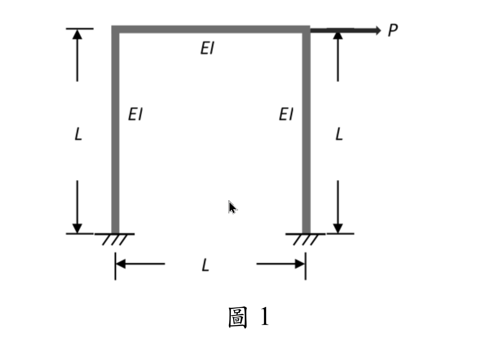
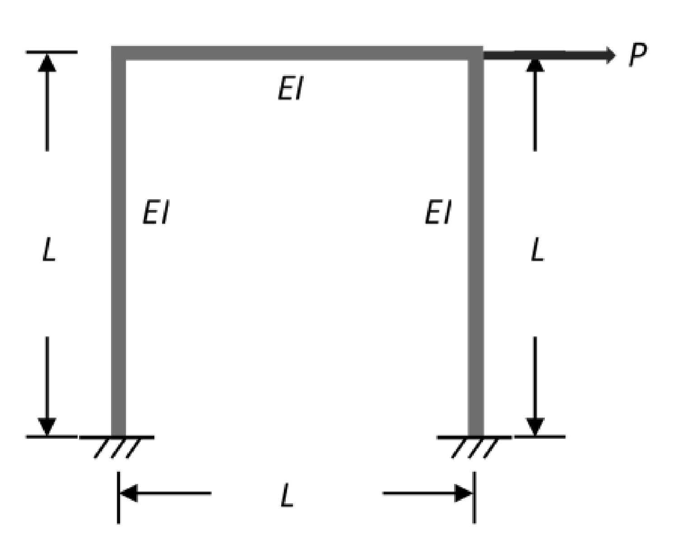

# SA-2025-1 題目正本

> 本檔只記錄考卷上寫了什麼、圖上畫了什麼，不含任何解法。解析見同資料夾 `SA-2025-1.md`。
> 判讀清單經使用者確認前，狀態為「待確認」；確認後本檔原則上不再修改（改動須回考卷原圖並記 log）。

| 項目 | 內容 |
|---|---|
| 考卷 | `raw/exams/SA-2025_結構學.pdf`，第 1 頁，第一題（圖 1） |
| 考年 | 2025（民國 114 年）專技高考結構工程技師「結構學」 |
| 配分 | 25 分 |
| 附圖 | `SA-2025-1-fig-1.png`、`SA-2025-1-fig-2.png` |
| 判讀狀態 | **已確認**（2026-11-05 使用者確認。原轉錄：2026-11-05 轉錄；PyMuPDF 110 dpi 整頁＋250–800 dpi 局部放大、PDF 向量座標；盲讀於開啟解析前完成） |

## 1. 考卷原文（逐字）

一、如圖 1 所示之一層樓單跨度剛構架（Rigid-jointed frame），梁及柱皆為垂直剛接，兩柱底為固定支承。梁柱之撓曲剛度均為 EI，長度均為 L。若忽略所有桿件之軸向變形，請推導對應側向作用力 P 之側向勁度（提示：請先寫出結構之勁度矩陣）。（25 分）

## 2. 考卷給的公式、附表與參數

- 考卷沒有給任何參考公式或附表。
- 梁柱 EI、長度 L 相同；忽略軸向變形（題文）。
- 附圖為點陣圖（PDF 內嵌），節點沒有字母標示。
- 卷首注意事項：可以使用電子計算器。不必抄題，作答時請將試題題號及答案依照順序寫在試卷上，於本試題上作答者，不予計分。本科目除專門名詞或數理公式外，應使用本國文字作答。
- 考試時間：2 小時。

## 3. 附圖

*證據圖 SA-2025-1-fig-1.png*

*證據圖 SA-2025-1-fig-2.png（2026-11-05 自考卷重新擷取 500 dpi，無游標）*

圖面文字照錄：P、EI、EI、EI、L、L、L、圖 1

## 4. 判讀清單

| # | 項目 | 判讀 | 圖上／題文依據 | 把握 |
|---|---|---|---|---|
| 1 | 幾何 | 柱高 L（左右兩側尺寸線）、梁長 L（下方尺寸線） | 附圖 | 確定 |
| 2 | 撓曲剛度 | 梁、柱皆 EI | 圖上標註；題文 | 確定 |
| 3 | 梁柱接點 | 剛接 | 題文「垂直剛接」 | 確定 |
| 4 | 支承 | 兩柱底固定 | 題文；附圖剖線 | 確定 |
| 5 | 載重 | P 水平向右，作用於右上角點 | 附圖箭頭由右上角點向右 | 確定 |
| 6 | 節點標示 | 考卷附圖**沒有**節點字母 | 附圖 | 確定 |
| 7 | 所求 | 對應 P 的側向勁度（提示先寫結構勁度矩陣） | 題文 | 確定 |
| 8 | 證據圖 | 舊截圖 fig-1：滑鼠游標（箭頭）在框架內部空白處，未壓到圖；新增 fig-2（2026-11-05 自考卷重新擷取 500 dpi） | — | 確定 |

---
*轉錄：2026-11-05（SA-U2-4 題目正本推廣・批 1）*
*確認：2026-11-05 使用者確認*
