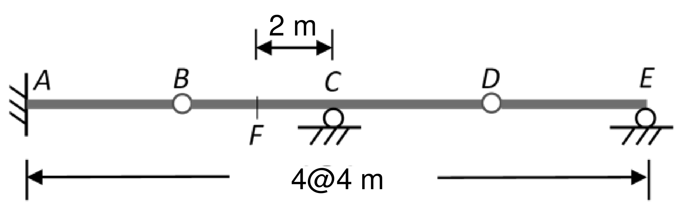

# SA-2025-2 題目正本

> 本檔只記錄考卷上寫了什麼、圖上畫了什麼，不含任何解法。解析見同資料夾 `SA-2025-2.md`。
> 判讀清單經使用者確認前，狀態為「待確認」；確認後本檔原則上不再修改（改動須回考卷原圖並記 log）。

| 項目 | 內容 |
|---|---|
| 考卷 | `raw/exams/SA-2025_結構學.pdf`，第 1 頁（頁次 2－1），第二題（圖 2） |
| 考年 | 2025（民國一百一十四年）專技高考結構工程技師「結構學」 |
| 配分 | 25 分 |
| 附圖 | `SA-2025-2-fig-2.png`（2026-11-07 重新擷取）；既有 `SA-2025-2-fig-1.png` |
| 判讀狀態 | **已確認**（2026-11-07 使用者確認。原轉錄：2026-11-07 轉錄；PyMuPDF 110 dpi 整頁＋450–1200 dpi 局部放大；考卷可抽文字，逐字原文以 PDF 文字層核對；盲讀於開啟解析前完成） |

## 1. 考卷原文（逐字）

二、請畫出圖 2 梁之 A 點反力（R_A）、C 點反力（R_C）、E 點反力（R_E）、A 點彎矩（M_A）及 F 點剪力（V_F）之影響線圖，其中 A 為固定支承、C 及 E 為滾支承（Roller），B 及 D 為內鉸接（Internal pin）。（25 分）

## 2. 考卷給的公式、附表與參數

- 考卷沒有給任何參考公式或附表。
- 靜定梁，不需 EI。
- 卷首注意事項：㈠可以使用電子計算器。㈡不必抄題，作答時請將試題題號及答案依照順序寫在試卷上，於本試題上作答者，不予計分。㈢本科目除專門名詞或數理公式外，應使用本國文字作答。
- 考試時間：2 小時。

## 3. 附圖

*證據圖 SA-2025-2-fig-2.png（2026-11-07 自考卷 500 dpi 重新擷取）；既有 SA-2025-2-fig-1.png 帶有滑鼠游標（箭頭游標在左下尺寸線旁），保留不改。*

圖面文字照錄：2 m、A、B、C、D、E、F、4@4 m、圖 2

## 4. 判讀清單

| # | 項目 | 判讀 | 圖上／題文依據 | 把握 |
|---|---|---|---|---|
| 1 | 座標 | A(0)、B(4)、C(8)、D(12)、E(16)，F(6)，單位 m | 下方「4@4 m」；上方 2 m 尺寸線由 F 量到 C（500 dpi，F 刻線量得 5.94 m） | 確定 |
| 2 | 支承 A | 固定端 | 題文＋左側牆剖線 | 確定 |
| 3 | 支承 C、E | 滾支承 | 題文＋圓圈 | 確定 |
| 4 | B、D | 內鉸（梁上空心圓） | 題文＋圖面 | 確定 |
| 5 | F 點 | BC 段上，距 C 左方 2 m（即 BC 中點） | 2 m 尺寸線 | 確定 |
| 6 | 靜定性 | 反力 5、平衡 3＋內鉸 2：靜定 | 計數 | 確定 |
| 7 | 所求 | R_A、R_C、R_E、M_A、V_F 影響線 | 題文 | 確定 |

---
*轉錄：2026-11-07（SA-U1-3 題目正本推廣・批 1）*
*確認：2026-11-07 使用者確認*
