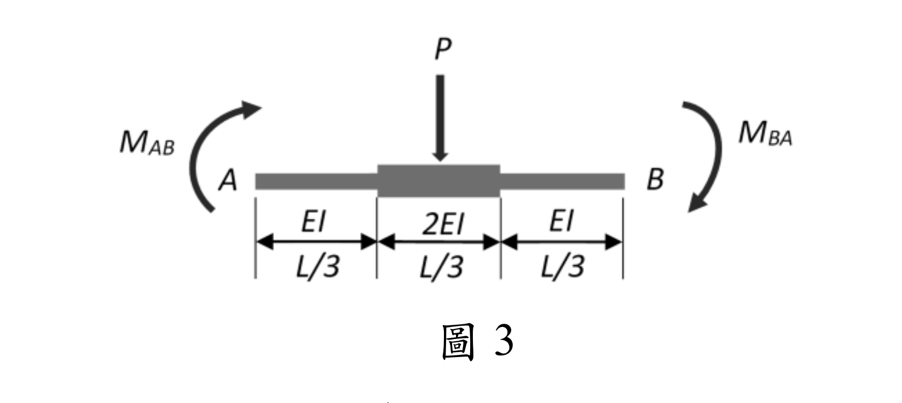

# SA-2025-3 題目正本

> 本檔只記錄考卷上寫了什麼、圖上畫了什麼，不含任何解法。解析見同資料夾 `SA-2025-3.md`。
> 判讀清單經使用者確認前，狀態為「待確認」；確認後本檔原則上不再修改（改動須回考卷原圖並記 log）。

| 項目 | 內容 |
|---|---|
| 考卷 | `raw/exams/SA-2025_結構學.pdf`，第 2 頁上半，第三題（圖 3） |
| 考年 | 2025（民國 114 年）專技高考結構工程技師「結構學」 |
| 配分 | 25 分 |
| 附圖 | `SA-2025-3-fig-1.png` |
| 判讀狀態 | **已確認**（2026-11-07 使用者確認。原轉錄：2026-11-05 轉錄；PyMuPDF 110 dpi 整頁＋500 dpi 局部放大；盲讀於開啟解析前完成） |

## 1. 考卷原文（逐字）

三、一非均勻斷面之桿件 AB，跨度中央承受集中載重 P，桿件各段之長度及撓曲剛度如圖 3 所示。請推導使用傾角變位法（Slope-deflection method）時，AB 桿件兩端彎矩 MAB 及 MBA 之傾角變位公式。（25 分）

## 2. 考卷給的公式、附表與參數

- 考卷沒有給任何參考公式或附表。
- 沒有畫支承（為單一桿件的自由體）。
- 題文沒有說明公式是否要含弦轉角（兩端相對側移）項。
- 卷首注意事項：㈠可以使用電子計算器。㈡不必抄題，作答時請將試題題號及答案依照順序寫在試卷上，於本試題上作答者，不予計分。㈢本科目除專門名詞或數理公式外，應使用本國文字作答。
- 考試時間：2 小時。

## 3. 附圖

*證據圖 SA-2025-3-fig-1.png*

圖面文字照錄：P、MAB、A、B、MBA、EI、2EI、EI、L/3、L/3、L/3、圖 3

## 4. 判讀清單

| # | 項目 | 判讀 | 圖上／題文依據 | 把握 |
|---|---|---|---|---|
| 1 | 分段 | A 端起三段各 L/3：EI、2EI、EI（對稱） | 下方三段尺寸線與剛度標示；中段畫較粗 | 確定 |
| 2 | 載重 | P 向下，作用於跨中（中段中點） | 箭頭在中段中央 | 確定 |
| 3 | MAB | 作用於 A 端，順時針 | A 左側弧形箭頭由下往上繞向右（500 dpi） | 確定 |
| 4 | MBA | 作用於 B 端，順時針 | B 右側弧形箭頭由上往下繞 | 確定 |
| 5 | 支承 | 沒有畫支承（單桿自由體） | 圖面 | 確定 |
| 6 | 所求 | MAB、MBA 的傾角變位公式 | 題文 | 確定 |
| 7 | 考卷沒有給 | 公式是否含弦轉角 ψ（兩端相對側移）；θ、ψ 的正向 | 題文、圖面 | 確定（解讀）：採一般式（含 θA、θB、ψ 與固端彎矩），正向與附圖彎矩箭頭一致取順時針；使用者確認 |

---
*轉錄：2026-11-05（SA-U2-3 題目正本推廣・批 2）*
*確認：2026-11-07 使用者確認*
