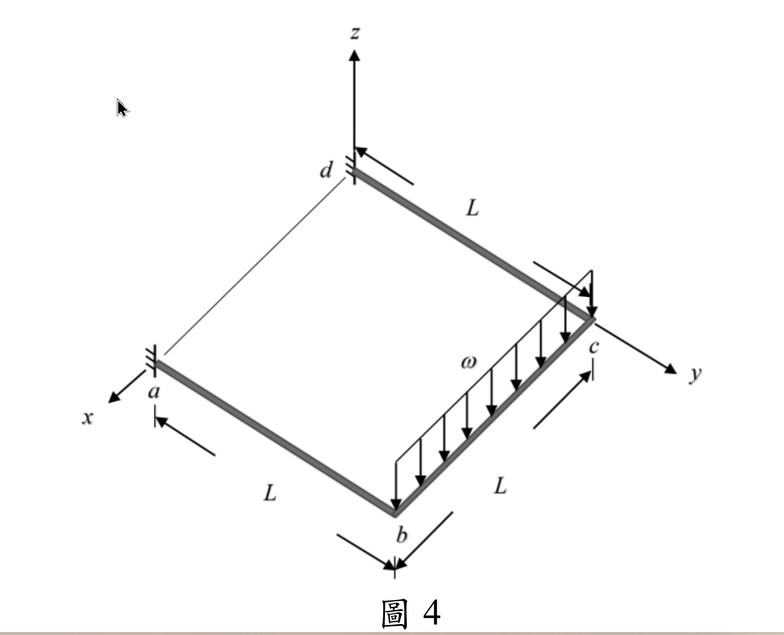
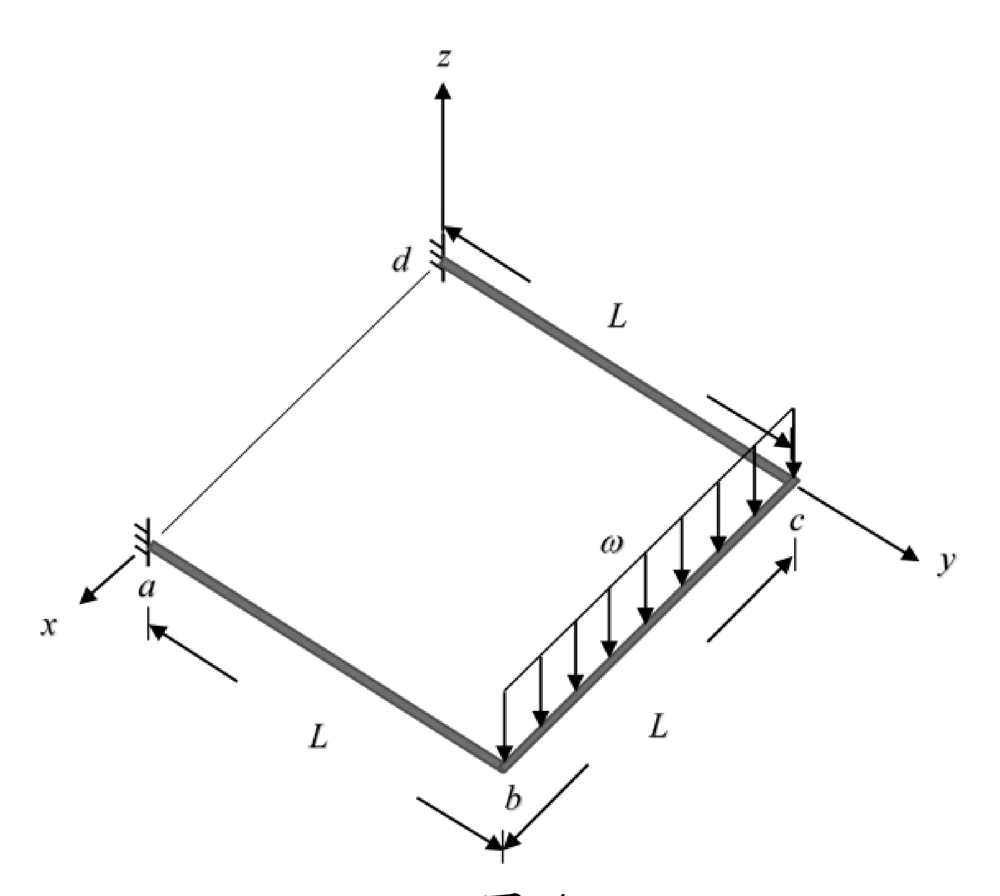

# SA-2025-4 題目正本

> 本檔只記錄考卷上寫了什麼、圖上畫了什麼，不含任何解法。解析見同資料夾 `SA-2025-4.md`。
> 判讀清單經使用者確認前，狀態為「待確認」；確認後本檔原則上不再修改（改動須回考卷原圖並記 log）。

| 項目 | 內容 |
|---|---|
| 考卷 | `raw/exams/SA-2025_結構學.pdf`，第 2 頁，第四題（圖 4） |
| 考年 | 2025（民國 114 年）專技高考結構工程技師「結構學」 |
| 配分 | 25 分 |
| 附圖 | `SA-2025-4-fig-1.png`、`SA-2025-4-fig-2.png` |
| 判讀狀態 | **已確認**（2026-11-05 使用者確認；影響答案項目定案：解析座標 x、y 與考卷對調，使用者決定數值不動、§1 加座標對照。原轉錄：2026-11-05 轉錄；PyMuPDF 110 dpi 整頁＋250–800 dpi 局部放大、PDF 向量座標；盲讀於開啟解析前完成） |

## 1. 考卷原文（逐字）

四、圖 4 所示 abcd 為一位於 xy 平面上的構架，a 及 d 為固定端，ab 及 bc 桿垂直剛接於 b 點，bc 及 cd 桿垂直剛接於 c 點。ab、bc 及 cd 三根桿件皆為長度 L 的實心圓桿，其彈性模數為 E，剪力模數為 G，慣性矩為 I。已知 bc 桿件受到負 z 軸方向的均布載重 ω。若不考慮桿件的軸向變形，請以勁度法求所有自由度之變位（含位移及轉角），及 a、d 兩支承之反力。（25 分）

## 2. 考卷給的公式、附表與參數

- 考卷沒有給任何參考公式或附表。
- E、G、I；實心圓桿（扭轉常數由斷面形狀推得，考卷沒有直接給 J）；不考慮軸向變形（題文）。
- 附圖為點陣圖（PDF 內嵌）。
- 卷首注意事項：可以使用電子計算器。不必抄題，作答時請將試題題號及答案依照順序寫在試卷上，於本試題上作答者，不予計分。本科目除專門名詞或數理公式外，應使用本國文字作答。
- 考試時間：2 小時。

## 3. 附圖

*證據圖 SA-2025-4-fig-1.png*

*證據圖 SA-2025-4-fig-2.png（2026-11-05 自考卷重新擷取 500 dpi，無游標）*

圖面文字照錄：z、d、L、c、ω、y、a、x、L、L、b、圖 4

## 4. 判讀清單

| # | 項目 | 判讀 | 圖上／題文依據 | 把握 |
|---|---|---|---|---|
| 1 | 座標（d 為原點） | d(0,0,0)、a(L,0,0)、b(L,L,0)、c(0,L,0) | 附圖 x、y 軸方向；三段尺寸 L | 確定 |
| 2 | 構件 | ab、bc、cd 三桿（a–d 細線不是桿件） | 題文「三根桿件」；附圖粗灰線三段、a–d 為細線 | 確定（解讀）；使用者確認 |
| 3 | 接點 b、c | 垂直剛接 | 題文 | 確定 |
| 4 | 支承 a、d | 固定端 | 題文；附圖短剖線 | 確定 |
| 5 | 斷面 | 實心圓桿；E、G、I | 題文 | 確定 |
| 6 | 載重 | ω 沿 −z 方向，bc 全長 | 題文；附圖箭頭由 b 排到 c | 確定 |
| 7 | 考卷沒有給 | 扭轉常數 J 的數值（題文只說實心圓桿） | — | 確定 |
| 8 | 所求 | 所有自由度的位移與轉角；a、d 反力；限勁度法 | 題文 | 確定 |
| 9 | 證據圖 | 舊截圖 fig-1：左上空白處有滑鼠游標（箭頭），下方多截到一條橫線；新增 fig-2（2026-11-05 自考卷重新擷取 500 dpi） | — | 確定 |

---
*轉錄：2026-11-05（SA-U2-4 題目正本推廣・批 1）*
*確認：2026-11-05 使用者確認*
