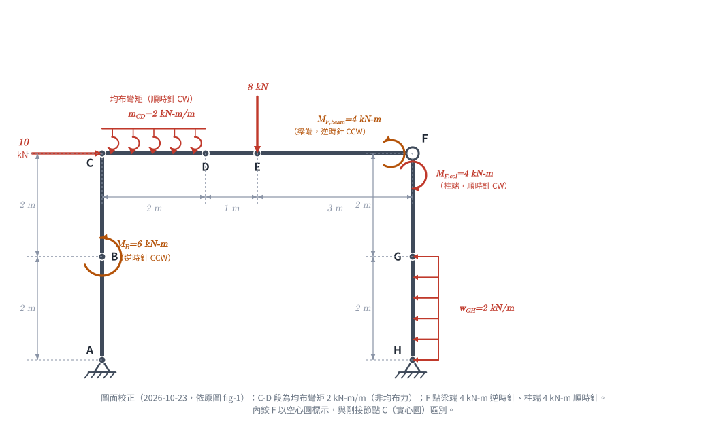
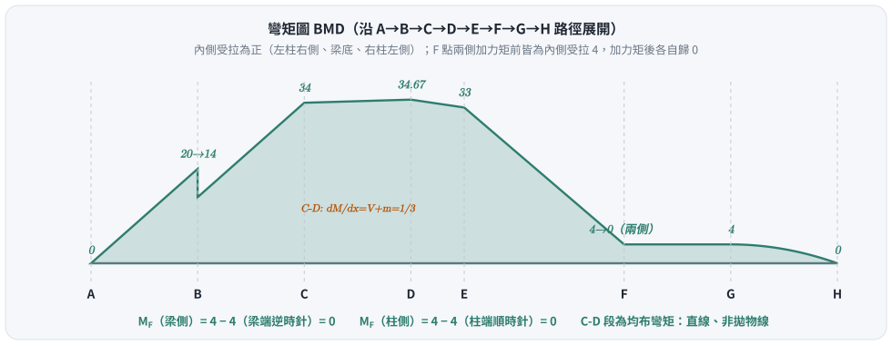

# 考題編號：SA-2002-1

**主分類：** `SA-U1-2` 靜定結構之分析
**分析法：** 靜定分析
**標籤：** `靜定剛架` `內鉸` `集中力矩` `均布彎矩` `剪力彎矩圖`

---

## 1. 原始題目重述 (Problem Restatement)
如下圖所示之剛架結構，點F 為內鉸，在各種外力作用下，試繪其軸力圖、剪力圖及彎矩圖。（25 分）

*圖說：本結構為一非對稱剛架，A點與H點為鉸支承。左側柱高4m，於y=2m處(B點)受6 kN-m逆時針集中彎矩；頂部C點受10 kN向右集中力。橫梁長6m，C到D(2m)受 2 kN-m/m 之**均布彎矩**（原圖為一排小弧形箭頭，順時針；不是均布力），E點(x=3m)受8 kN向下集中力。右側柱高4m，下半段H到G(2m)受2 kN/m向左均布載重。F點為內鉸，梁端與柱端各受4 kN-m之集中彎矩（**梁端逆時針，柱端順時針**）。*

*圖 2　校正後之向量重繪。C-D 段為均布彎矩 $m_{CD}=2$ kN-m/m（順時針）；F 點梁端 4 kN-m 逆時針、柱端 4 kN-m 順時針，各自畫在所屬桿端旁；內鉸 F 以空心圓標示，與剛接節點 C（實心圓）區別。*

## 2. 考題核心精神與出題者意圖 (Core Concepts & Examiner's Intent)
本題測驗的核心觀念為**靜定結構的整體與局部平衡**，以及**內鉸、集中力矩與均布彎矩的處理細節**。
出題者刻意在內鉸 F 點的相鄰桿端加上集中力矩（梁端 4 kN-m 逆時針，柱端 4 kN-m 順時針），藉此測驗考生是否清楚「內鉸本身彎矩為零，但緊鄰內鉸的桿端內力會因外部集中力矩而不為零」的觀念。C-D 段的**均布彎矩**更是少見的載重型式：它不產生任何橫向力，所以剪力圖不變，但彎矩圖的斜率會被改變（$dM/dx = V + m$），專門測驗考生是否只會背「剪力是彎矩的斜率」。

## 3. 解題戰略地圖與陷阱分析 (Strategic Roadmap & Trap Analysis)
**作戰計畫：**
1. **分離體平衡：** 將結構由內鉸 F 點拆分為左右兩分離體（左：A-B-C-D-E-F，右：F-G-H）。
2. **求解反力：** 利用右側分離體對 H 點取矩求得 F 點水平力 $P$，再利用左側分離體對 A 點取矩求得 F 點垂直力 $Q$。接著利用各分離體的 $\Sigma F_x=0$ 與 $\Sigma F_y=0$ 求解 A、H 的支承反力。
3. **分段內力計算：** 依據求得之反力，逐段計算軸力(N)、剪力(V)與彎矩(M)。
4. **繪製內力圖：** 標示關鍵點數值，特別注意集中力矩造成的彎矩圖跳躍、均布彎矩造成的彎矩斜率改變，以及均布載重造成的二次拋物線。

**陷阱分析：**
- ⚠ **陷阱一：F點集中力矩的歸屬。** 鉸 F 本身不能承受彎矩，圖示的兩個 4 kN-m 集中力矩應視為分別作用於「梁 CF 的右端」（逆時針）與「柱 FH 的頂端」（順時針）。在取分離體平衡時，必須將對應的力矩納入該分離體中。
- ⚠ **陷阱二：C-D 段是均布彎矩，不是均布力。** 原圖 C-D 上方是一排**小弧形箭頭**、單位 kN-m/m，與右柱 G-H 的直線箭頭（kN/m）不同。若誤當成 2 kN/m 向下均布力，$A_y$、剪力圖、彎矩圖全錯。均布彎矩的合力為一個力偶 $2\times2=4$ kN-m（順時針），**對任何點取矩都是 −4**，與力臂無關；它也**不進入** $\Sigma F_x$、$\Sigma F_y$。
- ⚠ **陷阱三：彎矩圖跳躍方向。** 在 B 點有 6 kN-m 的逆時針集中力矩，會造成彎矩圖跳躍；判斷跳躍方向時，務必以分離體切面平衡為準，並仔細比對原圖弧形箭頭的實際轉向。
- ⚠ **陷阱四：柱頂與梁端的內力轉換。** 在剛節點 C 處，柱頂的彎矩與剪力將轉換為梁端的彎矩與軸力，轉換過程需繪製節點 C 的自由體圖確認符號與方向。

## 3.5 變數層次分析 (Variable Hierarchy Analysis)

### 最終目標
`求出所有支承反力，並精確繪製各桿件的軸力(AFD)、剪力(SFD)與彎矩圖(BMD)`

### 本題關鍵公式（依計算順序）
- 鉸接點拆解平衡（右部分）：$\sum M_H = 0 \implies P$
- 鉸接點拆解平衡（左部分）：$\sum M_A = 0 \implies Q$
- 各分離體力平衡：$\sum F_x = 0 \implies A_x, H_x$，$\sum F_y = 0 \implies A_y, H_y$
- 桿件內力關係：$\dfrac{dV}{dx} = -w(x)$，$\dfrac{dM}{dx} = V + m(x)$（$m$ 為均布彎矩，順時針為正、彎矩以梁底受拉為正）

### L1：題目直接給定
- **符號 ∣ 數值 ∣ 說明**
  - $L_{AC}$ ∣ $4 \text{ m}$ ∣ 左柱高度
  - $L_{CF}$ ∣ $6 \text{ m}$ ∣ 橫梁長度
  - $L_{FH}$ ∣ $4 \text{ m}$ ∣ 右柱高度
  - $P_C$ ∣ $10 \text{ kN}$ (向右) ∣ C 點集中水平力
  - $M_B$ ∣ $6 \text{ kN-m}$ (逆時針) ∣ B 點集中力矩
  - $m_{CD}$ ∣ $2 \text{ kN-m/m}$ (順時針) ∣ CD 段均布彎矩
  - $P_E$ ∣ $8 \text{ kN}$ (向下) ∣ E 點集中垂直力
  - $w_{GH}$ ∣ $2 \text{ kN/m}$ (向左) ∣ GH 段均布載重
  - $M_{F,beam}$ ∣ $4 \text{ kN-m}$ (逆時針) ∣ F 點橫梁端集中力矩
  - $M_{F,col}$ ∣ $4 \text{ kN-m}$ (順時針) ∣ F 點右柱端集中力矩

### L2：需知識點推導
**求解支承反力與鉸接力**
- **符號 ∣ 公式／來源 ∣ 卡關?**
  - $P, Q$ ∣ F 點內鉸分離體平衡 ∣
  - $A_x, A_y$ ∣ 左部分離體力平衡 ∣
  - $H_x, H_y$ ∣ 右部分離體力平衡 ∣

### L3：深層知識（不懂就卡住）
- **知識點 ∣ 說明 ∣ 卡關?**
  - **內鉸外加力矩處理** ∣ 內鉸 $M=0$，外部力矩應直接施加於分離體的桿端，不影響鉸本身的彎矩傳遞 ∣
  - **均布彎矩** ∣ 只產生力偶、不產生力；剪力不變，彎矩斜率 $dM/dx = V + m$ ∣
  - **節點內力轉換** ∣ 剛接點 C 的柱頂剪力轉換為梁軸力，柱頂軸力轉換為梁剪力，彎矩則依節點平衡連續 ∣

## 4. 步驟化詳細計算過程 (Step-by-Step Detailed Calculation)

### Step 1: 拆解結構與反力計算

> **載重校正說明（2026-10-23）：** 依原圖 fig-1 重新判讀：①C-D 段為**均布彎矩** 2 kN-m/m（順時針），非 2 kN/m 向下均布力；②F 點梁端 4 kN-m 為**逆時針**、柱端 4 kN-m 為**順時針**（前版兩者相反）；③B 點 6 kN-m 逆時針維持不變。前版據錯誤載重算出的反力與內力已全部重算。

將結構於 F 點拆開，設「左分離體作用於右分離體」在 F 點的力為 $(P,Q)$（$P$ 向右為正、$Q$ 向上為正）。

針對**右分離體 (F-G-H)**，H 為鉸支承有 $H_x, H_y$，另受柱端力矩 $M_{F,col}=4\text{ kN-m}$（順時針）及 GH 段均布載重合力 $2\times2=4\text{ kN}$（向左，作用於 G-H 中點）。
- 對 H 點取力矩 $\sum M_H = 0$（逆時針為正）：
  $$ -P \times 4 + (2 \times 2) \times 1 \text{ (均布載重合力)} - 4 \text{ (柱端順時針力矩)} = 0 $$
  $$ -4P + 4 - 4 = 0 \implies \boxed{P = 0} $$
- $\sum F_x = 0$：
  $$ H_x + P - (2 \times 2) = 0 \implies \boxed{H_x = 4 \text{ kN} \text{ (向右)}} $$

針對**左分離體 (A-B-C-D-E-F)**，F 點受右分離體之反作用力 $(-P,-Q)=(0,-Q)$，另受 B 點力矩 $M_B=6\text{ kN-m}$（逆時針）、C-D 均布彎矩合力偶 $2\times2=4\text{ kN-m}$（順時針）及梁端力矩 $M_{F,beam}=4\text{ kN-m}$（逆時針）。
- 對 A 點取力矩 $\sum M_A = 0$（逆時針為正）：
  $$ 6 \text{ (B)} - 10 \times 4 \text{ (C點水平力)} - 4 \text{ (CD均布彎矩)} - 8 \times 3 \text{ (E點力)} + 4 \text{ (梁端逆時針力矩)} + 6\times(-Q) = 0 $$
  $$ 6 - 40 - 4 - 24 + 4 - 6Q = 0 \implies -58 - 6Q = 0 \implies \boxed{Q = -\frac{29}{3} \text{ kN}} $$
- $\sum F_x = 0$：
  $$ A_x + 10 - P = 0 \implies \boxed{A_x = -10 \text{ kN} \text{ (向左)}} $$
- $\sum F_y = 0$（均布彎矩不貢獻任何力）：
  $$ A_y - 8 + (-Q) = 0 \implies A_y - 8 + \frac{29}{3} = 0 \implies \boxed{A_y = -\frac{5}{3} \approx -1.67 \text{ kN} \text{ (向下)}} $$

回到右分離體求 $H_y$：
- $\sum F_y = 0 \implies H_y + Q = 0 \implies \boxed{H_y = \frac{29}{3} \approx 9.67 \text{ kN} \text{ (向上)}}$

**整體平衡驗證**：
- $\Sigma F_x = A_x+10+H_x-4 = -10+10+4-4=0$ ✓
- $\Sigma F_y = A_y-8+H_y = -\frac{5}{3}-8+\frac{29}{3}=0$ ✓
- $\Sigma M_A = 6-40-4-24+4-4+6H_y+4\times1 = -62+58+4 = 0$ ✓（$6H_y=58$；GH 合力 4 kN 向左、作用高度 1 m，對 A 為逆時針 +4）

### Step 2: 各桿件內力計算 (以受拉側為彎矩正向)

#### 1. 左側柱 (A-B-C)
- **A-B段 (y = 0 ~ 2m)**：
  - 軸力：$N = -A_y = \boxed{+\frac{5}{3} \text{ kN} \text{ (拉)}}$（$A_y$ 向下，左柱受拉）
  - 剪力：$V = A_x = \boxed{-10 \text{ kN}}$
  - 彎矩：$M(y) = 10y$ (右側受拉，即內側)。$M_A = \boxed{0}$，$M_B^- = 10\times2 = \boxed{20 \text{ kN-m}}$ (右側受拉)。
- **B-C段 (y = 2 ~ 4m)**：
  - 軸力與剪力不變：$N = \boxed{+\frac{5}{3} \text{ kN}}$，$V = \boxed{-10 \text{ kN}}$
  - B點有 6 kN-m **逆時針**外加力矩，使右側受拉**減少**：$M_B^+ = 20 - 6 = \boxed{14 \text{ kN-m}}$ (右側受拉)。
  - $M(y) = 10y-6$。至 C 點：$M_C = 10(4)-6 = \boxed{34 \text{ kN-m}}$ (右側受拉)。

#### 2. 剛節點 C 之平衡
柱頂 C 點提供 34 kN-m (右側即內側受拉)，沿角隅內側連續，轉換為梁左端 34 kN-m 之彎矩 (底部即內側受拉)：$M_{CD}(0) = \boxed{+34 \text{ kN-m}}$。
柱頂剪力使柱對節點施加 10 kN 向左，恰與外力 10 kN (向右) 抵銷，橫梁軸力 $N = \boxed{0}$，與 F 點鉸傳水平力 $P = 0$ 一致。柱頂軸力（拉 $5/3$ kN，把節點往下拉）轉換為橫梁左端剪力 $V_{CD}(0) = \boxed{-\frac{5}{3} \text{ kN}}$。

#### 3. 橫梁 (C-D-E-F)
- **C-D段 (x = 0 ~ 2m)**：
  - 軸力：$N = \boxed{0}$
  - 剪力：均布彎矩不產生橫向力，剪力為常數 $V = \boxed{-\frac{5}{3} \text{ kN}}$。
  - 彎矩：取左段自由體對切點取矩，順時針均布彎矩每單位長度使梁底受拉增加 2：
    $$ M(x) = 34 + V x + m x = 34 - \frac{5}{3}x + 2x = 34 + \frac{x}{3} \quad (\text{底部受拉}) $$
    $dM/dx = V + m = \frac{1}{3}$，彎矩**緩升直線**（不是拋物線，段內無極值）。$M_D = 34 + \frac{2}{3} = \boxed{\frac{104}{3} \approx 34.67 \text{ kN-m}}$。
- **D-E段 (x = 2 ~ 3m)**：
  - 軸力：$N = \boxed{0}$
  - 剪力：$V = \boxed{-\frac{5}{3} \text{ kN}}$ (常數)
  - 彎矩：斜率回到 $V=-\frac{5}{3}$。$M_E = \frac{104}{3} - \frac{5}{3} \times 1 = \boxed{33 \text{ kN-m}}$ (底部受拉)。
- **E-F段 (x = 3 ~ 6m)**：
  - 軸力：$N = \boxed{0}$
  - E點有 8 kN 向下外力。剪力：$V = -\frac{5}{3} - 8 = \boxed{-\frac{29}{3} \text{ kN}}$ (常數)。
  - 彎矩：$M_F^- = 33 - \frac{29}{3} \times 3 = 33 - 29 = \boxed{4 \text{ kN-m}}$ (底部受拉)。
  - F點梁端有**逆時針** 4 kN-m 外部集中力矩，貢獻 $-4$：$M_F = 4-4 = \boxed{0 \text{ kN-m}}$ ✓ 符合內鉸零彎矩。

#### 4. 右側柱 (H-G-F)
- **H-G段 (y = 0 ~ 2m)**：
  - 軸力：$N = -H_y = \boxed{-\frac{29}{3} \text{ kN} \text{ (壓)}}$
  - 剪力：$V(y) = H_x - 2y = 4-2y$。$V_H = \boxed{4 \text{ kN}}$，$V_G = 4-4 = \boxed{0}$。
  - 彎矩（左側即內側受拉為正）：$M(y) = 4y - y^2$。
    $M_H = \boxed{0}$，$M(1) = \boxed{3 \text{ kN-m}}$，$M_G = 8-4 = \boxed{4 \text{ kN-m}}$（左側受拉）。$V_G = 0$，故拋物線頂點恰在 G 點、整段單調遞增。
- **G-F段 (y = 2 ~ 4m)**：
  - 軸力：$N = \boxed{-\frac{29}{3} \text{ kN} \text{ (壓)}}$
  - 剪力：$V = H_x - 4 = \boxed{0}$
  - 彎矩：剪力為零，彎矩為常數 $M = \boxed{4 \text{ kN-m}}$（左側受拉），$M_F^- = 4$。
  - F點柱端有**順時針** 4 kN-m 外部集中力矩，貢獻 $-4$：$M_F = 4-4 = \boxed{0 \text{ kN-m}}$ ✓ 符合內鉸零彎矩。

> **自我檢查的限度：** F 點兩側歸零是**必要**條件，但不是方向判讀的獨立驗證——求 $P$、$Q$ 時用的正是「F 兩側彎矩為零」這兩條方程式，只要計算沒有錯，載重方向判讀錯了照樣會歸零。真正的檢查是 Step 1 的整體 $\Sigma M_A=0$（含右分離體所有載重），以及回頭逐一比對原圖每個箭頭。

### Step 3: 繪製 AFD、SFD 與 BMD
*(詳細圖形請參照手繪補充)*
- **AFD**：左柱恆為 $+5/3$（拉），橫梁為 $0$，右柱恆為 $-29/3$（壓）。
- **SFD**：左柱恆為 $-10$；橫梁 C→E 恆為 $-5/3$（均布彎矩段剪力不變），E 點階梯降至 $-29/3$；右柱 H→G 由 $4$ 線性降至 $0$，G→F 為 $0$。
- **BMD** (畫於受拉側)：
  - **左柱(右側，即內側)**：0 $\xrightarrow{直線}$ 20 (跳躍至14) $\xrightarrow{直線}$ 34。
  - **橫梁(下側)**：34 $\xrightarrow{緩升直線（斜率 1/3）}$ 34.67 $\xrightarrow{直線}$ 33 $\xrightarrow{直線}$ 4 (梁端力矩使其跳躍至0)。
  - **右柱(左側，即內側)**：H→G 0 $\xrightarrow{二次曲線，G點切線垂直}$ 4；G→F 維持 4 (柱端力矩使其跳躍至0)。

*圖 3　BMD 路徑展開圖（內側受拉為正：左柱右側、梁底、右柱左側）。C-D 段因均布彎矩而斜率為 $V+m=1/3$；內鉸 F 的梁側（4−4=0）與柱側（4−4=0）各自歸零。*

## 5. 關鍵爭議點與進階探討 (Critical Issues & Advanced Discussion)
本題最大的考驗在於 F 點「雙集中力矩」的解讀。部分考生可能會誤將 4 kN-m 力矩直接加總或互相抵銷，而忽略了它們分別作用在內鉸兩側的實體桿件上。
標準作法是將它們**視為作用於分離體桿端的外力**，這樣一來內鉸本身的彎矩 $M=0$ 條件依然成立，且桿端的內部彎矩能與這些外部力矩平衡。解題時強烈建議如 Step 1 般拆解為左右兩自由體，即可避免符號混淆與漏算。

- **均布彎矩的判讀與處理**：C-D 段上方的小弧形箭頭與單位 kN-m/m，代表沿梁長連續分布的力矩。它是力偶，所以：①不進入任何力平衡方程式；②對任何點取矩都等於總量 $m\times L$，與力臂無關；③剪力圖在該段**不變**，只有彎矩斜率由 $V$ 變為 $V+m$。若誤當成均布力，會多出 4 kN 向下載重，$A_y$ 由 $-5/3$ 變成 $+7/3$，連帶剪力圖、彎矩圖全錯。
- **弧形力矩箭頭的判讀陷阱**：原圖 B、F 兩處集中力矩以手繪弧線＋箭頭表示轉向，肉眼一瞥容易看反（本解析前兩版即兩度判讀錯誤）。校正方法：找出弧線的箭頭端（終點），沿弧線由起點掃到終點，並注意**弧線的彎曲中心**在哪一側——同一段弧，圓心在左或在右，轉向就相反。必要時將圖片局部放大確認。

[互動圖形預覽](../../raw/solutions/SA-2002-1/SA-2002-1-sfd-bmd-viz.html)

---

*圖解補繪：2026-08-27（向量圖，腳本 `gen_SA-2002-1.py`，可重跑）*
*內力校正：2026-10-12（橫梁軸力、左柱與右柱 H-G 段受拉側）*
*載重校正：2026-10-23（C-D 段改為均布彎矩；F 點梁端改逆時針、柱端改順時針；反力與三圖全部重算）*
